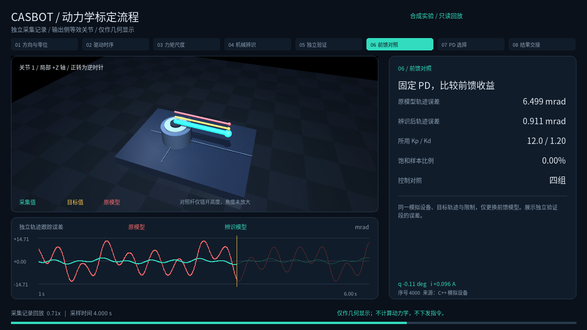

# casbot_calib

动力学标定实验框架：**C++ 模拟采集 → Python 时间处理与辨识 → 独立验证 → PD／前馈对照 → 报告**。现有单关节具备合成标定闭环，新增七轴R1统一模型与独立正确性检查；当前无实机控制入口。

当前实机目标已更新为：[腰部抱紧固定的14轴双臂动力学标定](docs/dual_arm_dynamics_plan.md)。已实现首个 [nominal双臂Mock流程](docs/dual_arm_workflow.md)：树形模型、14轴采集、多频激励、受限惯性/摩擦辨识、独立验证与中文回放。先做动力学，千分计/TriCal运动学暂缓；尚未接实机。

新版双臂流程已补方向／编码器软件零位、14轴电流响应和指令延迟辨识、1/2/4ms周期对照；实际多频行程扩大，并按完整周期回放。腕部加入非轴对称方向标记，几何角度不放大。[观看新版70秒中文视频](artifacts/dual_arm_workflow_v2_release/presentation_final/dual_calibration_zh.mp4)；阶段依据和运行说明见上方双臂文档。

模拟器包含等效惯量、摩擦、外部夹具弹簧、可选的单关节重力项、一阶电流响应、通信时序和简化单弦接触。双惯量只生成固定模型失配，不辨识减速器内部参数。`Kp/Kd` 控制增益与物理刚度 `spring` 严格区分。默认数值均不是 ENCOS 实测或厂家保证值。

Mock统一使用 [Boost.Odeint积分后端](docs/integration_backend.md)，保留整数纳秒事件调度；积分步在指令/采样边界截断。每次采集会记录实际后端版本和最大步长。

## 研发需求与标定规划

新需求的19项对应关系见 [需求—实验—验收—交付表](docs/requirements_matrix.md)，可筛选版本见 [CSV](docs/sources/requirements_matrix.csv)。当前双臂已实现固定名义质心/形状下的惯性比例与摩擦Mock辨识；完整惯量恢复、实机采集和产品验收仍待后续实施。

原单臂实现记录见 [五轮计划](docs/whole_arm_calibration_plan.md)，R1已实现Pinocchio模型与正确性检查。后续按新的双臂流程推进树形模型 → 14轴Mock/同步采集 → 激励设计与重力/摩擦/动态辨识 → 冻结验证和中文演示。

R1入口：`casbot-calib arm-check --output artifacts/my_r1`；增加 `--render` 生成中文七轴快照。详情见 [Pinocchio模型与验证](docs/arm_r1.md)。更新后的环境/锁文件包含Pinocchio原生依赖，安装锁文件后需重新安装本地包。

双臂入口：`casbot-calib dual-calibrate --output artifacts/my_dual --render`；观测重辨识：`casbot-calib dual-identify artifacts/my_dual --output artifacts/my_dual_reidentified`。使用 [双臂配置](configs/dual_arm_dynamics.yaml)，默认只运行Mock，设备先验/限制确认暂缓。

Pinocchio 扩展已加入刚体参数回归矩阵、含摩擦的正逆动力学解析导数、TCP世界方向雅可比和独立复用工作区。`arm-check` 同时输出参数列/单位契约、探针矩阵秩和数值核对；这些是后续标定的计算基础，不是已完成参数标定。

## 本机运行（bash）

本机已发现 `/opt/miniforge/condabin/conda`，环境名 `casbot_calib`。交互 bash 可这样接入：

```bash
source /opt/miniforge/etc/profile.d/conda.sh
conda activate casbot_calib
cd ~/codings/casbot_calib
python -m pip install -e . --no-build-isolation
cmake --preset dev
cmake --build --preset dev
ctest --preset dev
python -m pytest -q
OPENBLAS_NUM_THREADS=1 OMP_NUM_THREADS=1 casbot-calib suite --configs configs --output artifacts/my_validation
```

不依赖 shell 初始化的入口：

```bash
/opt/miniforge/condabin/conda run --no-capture-output -n casbot_calib casbot-calib run configs/A_basic.yaml --output artifacts/my_A
```

输出目录必须不存在，防止覆盖原始数据。完整实验通常为几十秒，实际耗时写入报告，不作为验收阈值。

## 新机器与 Windows

```bash
conda install -n base -c conda-forge conda-lock
conda-lock install -n casbot_calib conda-lock.yml
conda activate casbot_calib
python -m pip install -e . --no-build-isolation
cmake --preset dev
cmake --build --preset dev
ctest --preset dev
python -m pytest -q
casbot-calib suite --configs configs --output artifacts/validation
```

Windows 先安装 **Visual Studio 2022 Build Tools 的 C++ 工作负载与 Windows SDK**，在 Developer PowerShell／Developer Command Prompt 中激活 conda 后执行上述命令。conda 不打包 MSVC 编译器。Linux 编译器由锁文件提供；CMake 自动查找 conda 根目录和 Windows 的 `Library` 子目录。也可用 `conda env create -f environment.yml` 开发，但复现实验优先使用已提交的双平台锁文件。

CI 为 Linux、Windows 分别构建、执行 CTest、pytest、A–F 全套实验，并对关键数值按容差比较。**本机只能验证 Linux，Windows 实际结果以 CI 为准**。

## 六组实验

| 配置 | 验证内容 |
| --- | --- |
| [A_basic.yaml](configs/A_basic.yaml) | J/b/k/摩擦、多频、单频秩亏、十个噪声种子、自由关节、冷／热摩擦 |
| [B_gain.yaml](configs/B_gain.yaml) | 空载＋已知附加惯量联合辨识驱动增益；无尺度锚点拒绝恢复绝对参数 |
| [C_timing.yaml](configs/C_timing.yaml) | 1/2/4 ms 周期、固定／随动反馈、指令延迟、电流通道偏移、滤波失配、驱动响应、丢包／重复／抖动 |
| [D_mismatch.yaml](configs/D_mismatch.yaml) | 固定双惯量由单惯量模型拟合，独立低／高频残差 |
| [E_control.yaml](configs/E_control.yaml) | 原模型／辨识模型 × 基准／所选 PD，25 档网格，独立轨迹验收 |
| [F_string.yaml](configs/F_string.yaml) | 空扫、正反拨弦、深度变化、连续再拨；冻结空扫模型分析电流残差 |

单实验：`casbot-calib run configs/F_string.yaml --output artifacts/string_trial`。

每组输出 `report.json`、`report.md`、`metrics.csv` 和 PNG。每次采集独立保存 `observations.npz`、`commands.npz`、`observation_schema.json`、`metadata.json`、`evaluation_truth.npz`；原始数据不被预处理覆盖。单位通过独立 schema 验证，辨识函数和数据加载器不会读取真值文件或含真值的 metadata。

仅从观测重新辨识（删除真值仍可运行）：

```bash
casbot-calib identify artifacts/validation/A/friction --config configs/A_basic.yaml --output artifacts/reidentified.json
```

频率／延迟结果需结合采样带宽解释：快速电流响应配合稀疏同步采样，会产生有偏的表观偏移。C 实验同时报告充分采样基线与快速驱动压力场景，不能把所有相位误差解释为链路延迟。

## 代码与后续接入

| 位置 | 职责 |
| --- | --- |
| `cpp/include/casbot_calib/simulator.hpp` | 设备协议、能力、批量 Mock、模拟配置 |
| `cpp/src/simulator.cpp` | 虚拟时钟、驱动／传感器／链路／接触 |
| `cpp/include/casbot_calib/integration.hpp` | 统一Boost.Odeint RK4后端，供单轴/后续多轴复用 |
| `cpp/src/bindings.cpp` | 整段 NumPy 输入输出；模拟期间释放 GIL |
| `python/casbot_calib/identification.py` | 傅里叶解析求导、频带投影、SVD、约束鲁棒拟合、时序与增益辨识 |
| `python/casbot_calib/experiments.py` | A–F 编排、独立验证、控制选择 |
| `python/casbot_calib/data.py` | NPZ、JSON、SI 单位、原始数据摘要 |
| `scripts/compare_reports.py` | 跨平台关键数值比较，排除墙钟耗时 |

后续 SDK 只实现 C++ `JointDevice` 的 `write/read/capabilities`。`SimulationRunner` 持有虚拟时间推进能力；真实 SDK 不必模拟时间。先保存相同观测格式，再接现有 Python 流程。默认只有输出侧位置／速度／电流；由电流换算的力矩不是独立传感器。内环 PI 可调性和实际增益范围等待型号／固件资料确认。

详细见 [模型与参数](docs/model_and_parameters.md)、[实验协议与验收](docs/experiments.md)、[资料来源](docs/references.md)、[开发与 SDK 接入](docs/development.md)。本轮实测结果见 [验证记录](docs/validation.md)。

## 只读 MuJoCo 标定演示



新增八阶段演示：映射／方向检查 → 驱动响应 → 已知负载尺度 → 机械辨识 → 独立验证 → 固定 PD 前馈对照 → PD 选择 → 结果交接。C++ Mock 计算运动、Python 辨识；MuJoCo **只更新几何显示**，不参与动力学、积分或设备控制。

本机环境已装好 viewer。新机器可用可选双平台锁文件：

```bash
conda-lock install -n casbot_calib conda-viewer-lock.yml
conda activate casbot_calib
python -m pip install -e '.[viewer]' --no-build-isolation --no-deps
casbot-calib demo --config configs/workflow_demo.yaml --output artifacts/my_viewer_demo
```

演示现已统一驱动会话配置，已知负载确定增益后重新核验时序，再检查十个含噪批次、三档控制周期及其他关节固定时的重力模型。阈值在采集前声明，失败停止并保留记录。

默认生成中文 41 秒、1280×720、24 fps 视频、八张阶段截图、原始记录、JSON／CSV 报告和可复查的事件日志。本机已生成的完整视频位于 `artifacts/calibration_zh_release/presentation/calibration_workflow.mp4`，该目录按实验产物忽略，不提交进 Git。

交互回放：

```bash
casbot-calib view --run-folder artifacts/my_viewer_demo/records/direction_jog --mapping artifacts/my_viewer_demo/mapping.json
```

用空格暂停、R 重播、鼠标拖动旋转、滚轮缩放、Tab 切换检查关节。未来 SDK 可发布同一格式的原始遥测，通过 `view --telemetry-jsonl ... --follow` 接入；viewer 始终只读。

详见 [演示、方向检查及实机遥测接入](docs/viewer_demo.md)。已有 CASBOT 20251015 双臂模型也做了只读几何接入验证；自定义模型通过 `--scene` 和映射文件加载，不需要将模型动力学接入标定器。
