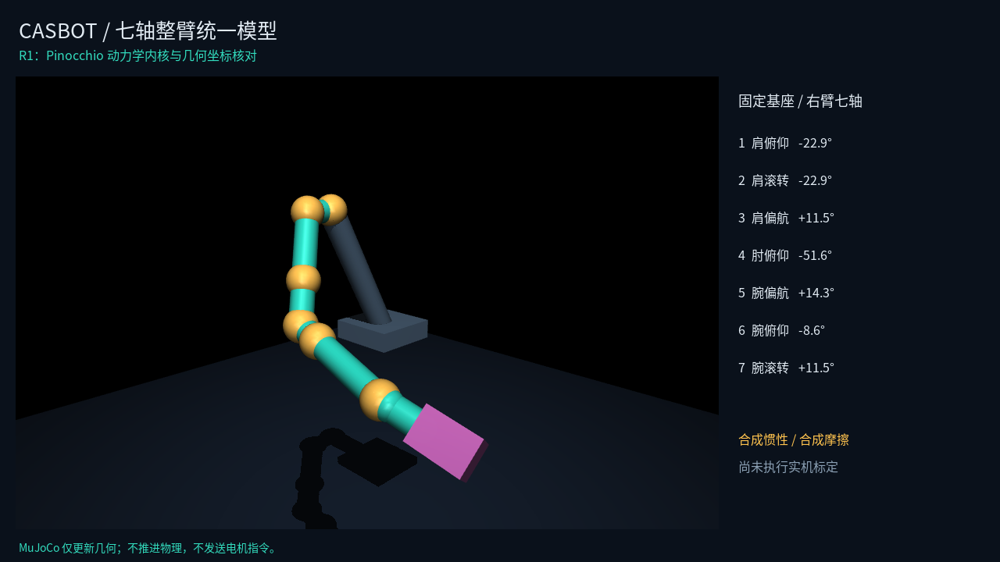

# R1：Pinocchio 整臂动力学内核

本轮实现固定基座串联转动关节的模型/计算接口，默认七轴右臂。后端固定使用 **Pinocchio 3.9.x**，当前 Linux/Windows 锁文件均为 3.9.0；不自行实现递归刚体动力学。Eigen 仅用于 Pinocchio 的矩阵接口、输入边界检查和分项组合。

R1 是模型正确性与几何核对，不是实机采集或标定。R2 七轴采集调度、R3 参数辨识和 R4 控制对照尚未实现。原单关节 A–F/demo 继续保留。

后续产品边界已更新为 [腰部夹具固定的14轴双臂动力学](dual_arm_dynamics_plan.md)，先做动力学、运动学暂缓。本页记录当前串联单臂实现，不能直接拼接左右关节替代树形模型。



## 运行与环境

```bash
source /opt/miniforge/etc/profile.d/conda.sh
conda activate casbot_calib
cd ~/codings/casbot_calib
# 更新环境后重新安装本地包；锁文件安装可能移除未列入锁文件的 editable 项目。
conda-lock install --no-mamba -n casbot_calib conda-viewer-lock.yml
CMAKE_BUILD_PARALLEL_LEVEL=1 python -m pip install -e '.[viewer]' --no-build-isolation --no-deps
casbot-calib arm-check --output artifacts/my_r1
MUJOCO_GL=egl casbot-calib arm-check --output artifacts/my_r1_with_geometry --render
```

`MUJOCO_GL=egl` 仅用于 Linux 无桌面渲染，Windows 使用正常桌面 OpenGL，不设置该变量。核心报告不需要导入 MuJoCo，也不需要运行时的 Python `pinocchio` 包；C++ Pinocchio 库是必需依赖。Python Pinocchio 仅用于重建源 URDF 的 FK 参考等开发工作。

Windows 在 VS 2022 Developer Shell 中安装 MSVC/Windows SDK、激活 conda、安装相同锁文件后构建；PowerShell 如需限制构建并行度，使用 `$env:CMAKE_BUILD_PARALLEL_LEVEL="1"`。本包在Windows导入时显式登记当前conda环境的 `Library/bin`，不依赖先导入Python Pinocchio来加载原生DLL。本机只验证Linux，Windows执行结果以CI为准。

输出目录须不存在。缺图形依赖/字体或几何核对失败时，`--render` 返回失败并保留核心检查、模型探针和错误原因；不丢掉已有数值结果。

## 计算接口及符号

| 接口 | 定义 / Pinocchio 计算 |
| --- | --- |
| `mass_matrix(q)` | CRBA 的对称质量矩阵，包含显式 `model.armature` |
| `gravity(q)` | `computeGeneralizedGravity`，维持给定姿态所需的重力补偿力矩 |
| `velocity_bias(q,dq)` | `nonLinearEffects - gravity`，即科氏/离心力矩向量 h，不单独定义一个常数 C |
| `friction(dq)` | 显式黏性 + 平滑库仑，可选稳态 Stribeck 项；不写入 Pinocchio 内置关节摩擦字段重复计算 |
| `inverse(q,dq,ddq)` | Pinocchio RNEA + 显式摩擦 |
| `forward(q,dq,torque)` | 先减显式摩擦，再交给 Pinocchio ABA；R1 不包含积分、驱动响应或接触 |
| `components(q,dq,ddq)` | M、M·ddq、h、重力、摩擦、总力矩；它们相加并与直接 RNEA 核对 |
| `fk(q)` | Pinocchio `forwardKinematics`；每个移动 link 的世界位姿，最后追加工具/TCP位姿 |
| `energy(q,dq)` | 动能定义为 0.5·dqᵀ·M·dq，M 来自 Pinocchio CRBA，保证转子项一致；势能由 Pinocchio `computePotentialEnergy` 计算 |
| `evaluate_batch(q,dq,ddq)` | N×J NumPy 输入；C++ 内整批计算并释放 GIL，输出各分项及 N×J×J 的 M |
| `workspace()` | 单独持有并复用 Pinocchio Data；可用于未来 C++ Mock / 控制计算循环 |
| `torque_regressor(q,dq,ddq)` | Pinocchio `computeJointTorqueRegressor`，J×10J，仅对应合并工具后的刚体参数 |
| `regressor_batch(q,dq,ddq)` | 批量输出 N×J×10J 回归矩阵、独立的转子力矩/名义摩擦分量和参数名称；不附带参数值 |
| `rigid_parameters()` / `rigid_parameter_names()` | 当前声明模型的刚体参数副本及其列名；不是已经辨识得到的参数 |
| `rotor_torque(ddq)` | 输出侧显式转子折算惯量 × ddq；回归矩阵不包含这一项 |
| `inverse_derivatives(q,dq,ddq)` | Pinocchio `computeRNEADerivatives`，返回总力矩对 q/dq/ddq 的导数，另加显式平滑摩擦导数 |
| `forward_derivatives(q,dq,torque)` | Pinocchio `computeABADerivatives`，返回加速度对 q/dq/总输入力矩的导数，应用减摩擦的链式法则 |
| `tool_jacobian(q)` | Pinocchio `computeJointJacobians` + `getFrameJacobian`，6×J，TCP 原点的世界方向线速度/角速度 |

力矩符号是产生指定运动所需的关节驱动力矩；自由空间下 `tau=M*ddq+h+gravity+friction`。`gravity_world` 是世界坐标系的重力加速度。后续驱动电流—力矩增益另存，不在 R1 力学接口里偷偷乘减速比。

批量接口在释放 GIL 前复制并检查输入，每批只创建一个 Pinocchio Data 并在样本间复用。引擎持有共享的不可变模型，支持同一引擎被并发读取，各批次的 Data 相互独立。无状态标量接口仍使用临时工作区；高频循环应显式持有 `workspace()`。C++ 每个工作线程分别持有工作区，同一个工作区不允许并发访问；Python 工作区方法保留 GIL，批量引擎方法释放 GIL。工作区持有模型，不要求原引擎对象持续存在。

工作区消除了重复创建 Data，返回矩阵等仍可能分配内存；这不是无分配实时接口，不以桌面机的微秒级平均耗时宣称满足硬实时或 DYN-4。

```python
import numpy as np
from casbot_calib import _core
from casbot_calib.arm_model import load_arm_model, default_arm_config

config = default_arm_config()
engine = _core.ArmDynamics(load_arm_model(config))
q = np.array(config['reference_pose'])
terms = engine.components(q, np.zeros(7), np.zeros(7))
print(engine.backend_version(), terms.gravity)
# 批量 q/dq/ddq 形状为 N×7，顺序固定为 config['joint_names']。
runtime = engine.workspace()
dq, ddq = np.zeros(7), np.ones(7) * .1
Y = runtime.torque_regressor(q, dq, ddq)
tau = Y @ engine.rigid_parameters() + runtime.rotor_torque(ddq) + runtime.friction(dq)
np.testing.assert_allclose(tau, runtime.inverse(q, dq, ddq))
print(runtime.tool_jacobian(q).shape)  # (6, 7)
print(runtime.inverse_derivatives(q, dq, ddq).dtau_da)  # M(q)
```

模型持有限位元数据，但纯计算接口不对 q/dq/力矩裁剪，也不将其等同于运行中的限位保护；轨迹约束与设备限幅将在 R2/R4 明确处理。

### 回归参数、导数与坐标系

每个移动关节的十个参数按 Pinocchio 顺序为 `mass, hx, hy, hz, Ixx, Ixy, Iyy, Ixz, Iyz, Izz`。`h=m*com`，惯量是关于**关节坐标系原点**的惯量，包含质心平移项；不是配置中的 `inertia_com`。单位依次为 kg、三个 kg·m、六个 kg·m²。工具经固定变换只合并到最后一组参数一次，不另增一组待估计列。默认七轴对应70列，不代表70个参数都能唯一辨识。

关系为 `tau = Y*pi + rotor_torque(ddq) + friction(dq)`。回归矩阵仅依赖几何、重力和运动状态，不读取名义惯性值生成特征；输出的摩擦/转子项取自当前声明模型，是先验计算值，不能当作独立测量或已经标定正确的参数。后续 R3 必须明确固定项/估计项、尺度来源、可辨识基空间与物理可行模型恢复；不能直接把任意70维最小二乘解灌回设备。

解析导数是**状态与输入导数**，不是对上述70个惯性参数的导数。`dtau_da=M`，`ddq_dtau=M^-1`，二者包含显式转子项；总模型的速度导数还包含平滑 Stribeck 摩擦的导数和相应链式法则。有限差分只用于验证，不是运行时导数后端。

TCP 雅可比使用 `LOCAL_WORLD_ALIGNED`：原点在 TCP，方向与世界坐标系一致，前3行是 TCP 线速度，后3行是角速度。不是世界原点的空间速度，也不是局部 TCP 坐标速度。固定基座安装旋转、工具偏置均计入。

在原有模型检查之外，`arm-check` 输出回归恒等式、探针矩阵列缩放/SVD秩、正逆动力学导数与有限差分比较、TCP雅可比和混合算法复用工作区的一致性。矩阵秩仅描述当前合成探针，不构成实机参数可辨识性验收。

```bash
# 桌面批量计时，不设置跨机器性能门槛；--baseline 可对照先前保存的探针。
python scripts/benchmark_arm_workspace.py --output artifacts/workspace_benchmark
```

## 模型与来源契约

默认配置为 [casbot_right_arm.json](../python/casbot_calib/assets/casbot_right_arm.json)，格式为 arm schema 1 / `serial_rigid_v1`，模型 ID 为 `casbot_20251015_right_arm_synthetic_v1`。

- 七轴顺序、轴、安装与工具变换来自已审计的 `casbot_dual_arm_benchmark_nominal.urdf`，保留源文件 SHA256；固定腰变换进入 base，另一臂不进入该固定基座右臂动力学。
- 连杆质量/COM/惯量使用明确的合成均匀盒体参数。源 URDF 惯性只作来源记录，未将其标为实测或用作这些盒体的真值。
- 原固定手部子树整体用一个合成刚性工具替代；工具惯性在工具坐标系定义，由 Pinocchio `appendBodyToJoint` 完成变换和合并，恰好加入一次。原手部质量不再额外导入。
- 转子折算惯量独立于 link 的 COM 惯量，直接写入 Pinocchio `model.armature`。默认配置显式为零；非零路径有独立解析测试，不采用旧 MJCF 的统一 0.2。
- 摩擦为单独合成配置，不采用旧 MJCF 的统一阻尼0.5。稳态 Stribeck 代理不等于静摩擦/预滑移/滞回已建模，更不等于其参数已经标定。
- 位置/力矩限制保留源 benchmark 的来源标记，尚不是 ENCOS 型号/固件的权威限制。

输入检查包括 SI 单位/版本、关节顺序、唯一名称、有限状态、单位轴、正规旋转、正质量、COM惯量正定及主惯量三角关系、非负耗散及合法限值。引擎对构造输入和返回的模型快照进行复制，调用者修改配置不会改变已有引擎。

源几何可重建：

```bash
python scripts/import_arm_fixture.py \
  ../casbot_tasks/scripts/casbot_dual_arm_model/models/casbot_dual_arm_benchmark_nominal.urdf
```

导入器同时用 Pinocchio 的完整 URDF parser 生成 [FK参考](../python/casbot_calib/assets/casbot_right_arm_fk_reference.json)。运行和测试用这两个小文件，不要求相邻 task 或 mesh 存在。FK参考用于校验几何提取，不作为独立的动力学正确性证明。

## 独立验收与产物

- 二连杆独立 Lagrange 解析式核对 M、h、重力、逆动力学，并用解析力矩验证 ABA；含非零耦合点、非零转子和带COM工具的专门例子。该解析代码仅作 oracle，不能被运行后端调用。
- 七轴检查 M 的对称/正定、速度为零时 h=0、静态等于重力、分项和等于RNEA、质量/速度耦合非零、势能梯度、Christoffel一致性与微分功—能关系。
- 三层几何核对：源 URDF parser FK → 紧凑配置的 Pinocchio FK → MuJoCo body/TCP几何。MuJoCo只调用既有 `mj_kinematics`/`mj_camlight`，禁止动力学API；另检查 qacc 未被计算。
- 校验批量/标量一致、模型快照、并发读取、错误输入、无MuJoCo/无Python Pinocchio核心报告，以及可选渲染失败保留报告。

本机产物：[artifacts/r1_pinocchio](../artifacts/r1_pinocchio/report.md)：

| 文件 | 含义 |
| --- | --- |
| `report.json` / `report.md` | 检查项、误差、后端/版本、时延和限制 |
| `arm_model.json` / `fk_reference.json` | 使用的模型来源与几何参考副本 |
| `model_probes.npz` | 合成输入 q/dq/ddq 及计算分项，不是观测记录，也不是标定数据 |
| `regressor_contract.json` | 回归列顺序、单位、力矩关系、已排除的项及导数/TCP约定 |
| `reference_pose_components.csv` | 固定探针下的逐轴分项力矩 |
| `mass_matrix.png` / `torque_components.png` | 构型相关耦合与分项计算图 |
| `arm_scene.xml` / `arm_mapping.json` / `arm_geometry.png` | 可选自包含七轴场景、合成SI映射和中文快照 |
| `geometry_check.json` | 几何FK误差及只读声明 |
| `evidence_sha256.json` | 本次报告/配置/图形/探针摘要 |

核心参考为 [Pinocchio官方项目](https://github.com/stack-of-tasks/pinocchio)，对应 [RNEA](https://github.com/stack-of-tasks/pinocchio/blob/v3.9.0/include/pinocchio/algorithm/rnea.hpp)、[CRBA](https://github.com/stack-of-tasks/pinocchio/blob/v3.9.0/include/pinocchio/algorithm/crba.hpp)、[ABA](https://github.com/stack-of-tasks/pinocchio/blob/v3.9.0/include/pinocchio/algorithm/aba.hpp)。项目代码只封装并验证这些计算，后续 Mock 和前馈复用此后端。

扩展接口直接依据当前安装的3.9.0头文件核对：[回归矩阵](https://github.com/stack-of-tasks/pinocchio/blob/v3.9.0/include/pinocchio/algorithm/regressor.hpp)、[惯性参数顺序](https://github.com/stack-of-tasks/pinocchio/blob/v3.9.0/include/pinocchio/spatial/inertia.hpp)、[RNEA导数](https://github.com/stack-of-tasks/pinocchio/blob/v3.9.0/include/pinocchio/algorithm/rnea-derivatives.hpp)、[ABA导数](https://github.com/stack-of-tasks/pinocchio/blob/v3.9.0/include/pinocchio/algorithm/aba-derivatives.hpp)、[坐标系与frame雅可比](https://github.com/stack-of-tasks/pinocchio/blob/v3.9.0/include/pinocchio/algorithm/frames.hpp)。
