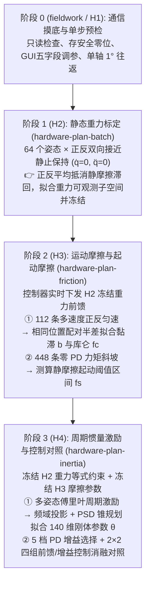

# 🦾 双臂动力学标定方案详解（原理、算法与 H1–H4 实机流程）

本文档用直观的工程语言梳理 `casbot_calib` 仓库中**双臂动力学标定**的整体架构、核心数学原理、底层代码分工，以及从实机联调（`fieldwork`）到分阶段整批标定（`H1 → H4`）与手腕专项（`路线 A / B`）的完整实现细节。

---

## 🧭 一、核心设计思想：为什么要“分阶段解耦 + 逐级冻结”？

机器人动力学方程包含三个物理来源完全不同的力矩项：
$$\tau = \underbrace{M(q)\ddot{q} + C(q, \dot{q})\dot{q}}_{\text{惯性与科氏/离心项}} + \underbrace{g(q)}_{\text{重力项}} + \underbrace{\tau_f(\dot{q})}_{\text{摩擦项}}$$

如果采集一条复杂轨迹，试图在一个大黑盒里同时拟合重力、摩擦和转动惯量，由于关节摩擦力矩和重力力矩往往比小关节（如手腕）的惯性力矩大一到两个数量级，微小的摩擦建模误差或相位滞后就会把转动惯量严重污染（甚至算出负质量、负惯量）。

因此，本仓库采用 **“分阶段解耦（Staged Decoupling）+ 物理一致性锥规划（PSD Conic Optimization）+ 逐级冻结（Sequential Freezing）”** 路线：



---

## ⚙️ 二、标定对象与底层代码架构

### 1. 标定对象与参数空间（140 维刚体参数 + 摩擦）
* **机器人模型**：腰部刚性固定的 **14 轴双臂机器人**（左臂 7 轴 + 右臂 7 轴）。当前默认模型为 `casbot_hl12p1_dvt2_bare_flange_1105_03_gauge_v2`（拆掉普通手部、带裸法兰的 DVT2 整机模型）。
* **单连杆 10 维标准参数**：每个关节连杆 $j$ 由 10 个对动力学方程呈线性的刚体惯性参数描述：
  $$\theta_j = [m, \; h_x, h_y, h_z, \; I_{xx}, I_{xy}, I_{yy}, I_{xz}, I_{yz}, I_{zz}]^T \in \mathbb{R}^{10}$$
  其中 $m$ 为连杆质量，$h = m \cdot c$ 为质心一阶矩，$I$ 为关于关节坐标系原点的 $3 \times 3$ 对称惯性张量。
* **整机待标定参数**：
  * **刚体惯性参数**：14 个关节合计 **$14 \times 10 = 140$ 维向量 $\theta \in \mathbb{R}^{140}$**。
  * **关节摩擦参数**：每轴独立的黏滞摩擦系数 $b_j$（$\text{Nm}\cdot\text{s/rad}$）、库仑摩擦系数 $f_{c,j}$（$\text{Nm}$）以及静摩擦起动阈值 $f_{s,j}$（$\text{Nm}$）。

### 2. C++ 与 Python 核心模块分工

| 模块 / 文件 | 职责与作用 |
| :--- | :--- |
| **[arm_dynamics.hpp](../cpp/include/casbot_calib/arm_dynamics.hpp)** (C++ Pinocchio) | 解析 URDF 树形模型，批量计算刚体回归矩阵 $Y(q, \dot{q}, \ddot{q}) \in \mathbb{R}^{14 \times 140}$（满足 $\tau_{\text{rigid}} = Y\theta + \tau_{\text{rotor}}$）、质量矩阵 $M(q)$、重力向量 $g(q)$ 与正运动学 FK。 |
| **[collision.hpp](../cpp/include/casbot_calib/collision.hpp)** (C++ Coal) | 基于机器人 16 个凸包外包络与环境夹具，对规划出的连续多项式轨迹（Bernstein 导数界）和实测折线做连续防碰撞证明（默认保持 **10mm** 安全余量）。 |
| **position_executor.cpp** (C++ ROS 2) | 实机与 SDK Mock 共用的实时控制发送器。申请 `/motion/upper_body_debug` 模式，以 500Hz 向 `/upper_body_debug/joint_cmd` 发送 14 轴五字段指令，并执行零 PD 力矩斜坡实时监控（`SdkBreakaway`）。 |
| **[rigid_identification.py](../python/casbot_calib/rigid_identification.py)** (Python Clarabel) | 组装 $4 \times 4$ 伪惯性矩阵半正定锥约束（PSD Cone）、阶段冻结等式约束与 SVD 零空间正则化，调用 Clarabel 求解物理合法的 140 维刚体参数。 |
| **staged_identification.py** / **staged_inertia.py** | 实现重力正反配对平均、匀速摩擦位置网格插值半差、傅里叶周期投影求导与惯量辨识的核心算法。 |
| **hardware_batch.py** / **hardware_friction.py** / **hardware_inertia.py** | 实机 H2、H3、H4 批次规划、断点续采（`--resume`）、起点自动重规划与离线报告生成。 |

---

## 🔬 三、各阶段数学原理与算法细节

### 1. 物理一致性保障：Clarabel 伪惯性矩阵 PSD 锥规划
详见 `[rigid_identification.py:14-138]`。在任何阶段求解 140 维刚体参数 $\theta$ 时，都会面临两个核心问题：
1. **不可观测方向（秩亏）**：例如静止状态完全测不到转动惯量；即使多轴运动，由于机械臂基座固定、关节轴方向受限，140 维参数中也只有一部分线性组合（可观测子空间）能被数据激励出来。
2. **物理合法性**：普通最小二乘很容易在弱可观测方向上算出“负质量”或“违反三角不等式的惯性张量”，导致导入仿真器或控制器时直接发散。

**仓库的解法（`fit_rigid`）**：
* **构造 $4 \times 4$ 伪惯性矩阵（Pseudo-Inertia Matrix）**：对每个连杆的 10 维参数 $\theta_j = (m, h, I)$，构造对称矩阵：
  $$J(\theta_j) = \begin{bmatrix} \frac{1}{2}\text{tr}(I)\mathbf{I}_3 - I & h \\ h^T & m \end{bmatrix} \succ 0$$
  根据刚体力学定理（Wensing et al., IEEE RA-L 2018），$\theta_j$ 对应真实物理质量分布的充要条件是 $J(\theta_j)$ 正定。代码将其转化为 Clarabel 的半正定锥约束 `PSDTriangleConeT(4)`。
* **SVD 子空间分解与零空间先验锚定**：对归一化后的回归矩阵 $A$ 做奇异值分解 $A = U \Sigma V^T$，提取可观测基底 $V_{\text{obs}}$，并构造不可观测零空间投影矩阵 $P_{\text{null}} = I - V_{\text{obs}}V_{\text{obs}}^T$。在可观测方向上由实测力矩数据主导拟合，在不可观测方向上通过正则项将参数锚定在 CAD 名义先验 $\theta_{\text{prior}}$ 附近。
* **迭代重加权鲁棒损失（IRLS）**：通过 4 轮类似 Huber 的权重迭代 $w_i = 1 / \sqrt{1 + (r_i / s)^2}$，抑制偶发采样毛刺对参数的影响。

---

### 2. H2 阶段：静态重力标定（正反接近抵消静摩擦）
* **配置文件**：configs/hardware_batch.yaml、[configs/static_field_nominal.yaml](../configs/static_field_nominal.yaml)
* **实现代码**：staged_identification.py (`identify_gravity`)
* **实验设计**：
  * 从 570 个无碰撞候选姿态中，按重力回归矩阵信息量选出每臂 **24 个训练姿态 + 8 个验证姿态**（双臂共 64 个静态姿态）。
  * 当机械臂停在目标姿态 $q^*$ 时（$\dot{q}=0, \ddot{q}=0$），实测力矩为 $\tau = Y(q^*, 0, 0)\theta + \tau_{\text{stiction}}$。
  * **关键技巧（正反双向接近）**：如果只从单方向走到 $q^*$ 停下，关节静摩擦 $\tau_{\text{stiction}}$ 会死死顶住重力，导致测出来的力矩有很大偏置。因此程序对**每一个姿态 $q^*$ 都规划两条轨迹**——一条从正向接近停稳，一条从反向接近停稳（共 128 条轨迹）。
  * 在求解时，将同一姿态正反两次接近的回归矩阵与力矩取平均：
    $$\bar{Y} = \frac{Y(q_+, 0, 0) + Y(q_-, 0, 0)}{2}, \quad \bar{\tau} = \frac{\tau_+ + \tau_-}{2}$$
    把方向相反的静摩擦滞回力矩直接抵消！同时把 $|\tau_+ - \tau_-|/2$ 记录为该姿态的静摩擦半差包络。

---

### 3. H3 阶段：运动摩擦与零 PD 起动摩擦
* **配置文件**：configs/hardware_friction.yaml
* **实现代码**：staged_identification.py (`friction_pair_projection`)、sdk_breakaway.hpp
* **前置条件**：冻结 H2 标定出的重力模型。在 H3 运行期间，`position_executor` 会实时根据实测角度计算冻结重力力矩 $\hat{\tau}_g(q)$ 并填入下发指令的 `effort` 前馈通道。

#### (1) 运动摩擦（黏滞 $b$ + 库仑 $f_c$，112 条匀速轨迹）
* **轨迹设计**：14 轴逐轴测试。每轴在 2 个训练姿态、1 个验证姿态下，分别以三档训练速度（`0.04, 0.08, 0.12 rad/s`）和两档验证速度（`0.06, 0.10 rad/s`）做正反向匀速往返，其余 13 轴保持静止。
* **为什么用“相同位置网格配对半差”？**：
  * 扣除 H2 重力后，残余力矩为 $\tilde{\tau}(q, \dot{q}) = \tau - \hat{\tau}_g(q) \approx b\dot{q} + f_c \tanh(\dot{q}/0.001) + \Delta \tau_g(q)$，其中 $\Delta \tau_g(q)$ 是未完全消干净的重力残差。
  * 注意到 $\Delta \tau_g(q)$ **只与位置 $q$ 有关，与运动方向无关**；而摩擦力与运动方向相反。
  * 因此算法在匀速平台段截取正向轨迹 $(q_+, v_+, \tilde{\tau}_+)$ 和反向轨迹 $(q_-, v_-, \tilde{\tau}_-)$，将它们**按角度位置插值对齐到同一个空间网格 $q_{\text{grid}}$（默认 24～48 个点）上**，然后相减取半差：
    $$\frac{\tilde{\tau}_+(q_{\text{grid}}) - \tilde{\tau}_-(q_{\text{grid}})}{2} = b \cdot \frac{v_+ - v_-}{2} + f_c \cdot \frac{\tanh(v_+/0.001) - \tanh(v_-/0.001)}{2}$$
  * 这样残余重力误差 $\Delta \tau_g(q)$ 被完美消去，再通过带非负约束（$b \ge 0, f_c \ge 0$）的鲁棒最小二乘直接解出每轴的 $b$ 和 $f_c$。

#### (2) 起动摩擦（静摩擦阈值 $f_s$，448 条零 PD 力矩斜坡）
* **怎么在不飞车的前提下测静摩擦？**：
  1. 先用正常 PD 把目标轴停在测试姿态，静置 `1.0s` 或 `2.0s`。
  2. **把目标轴的 $K_p$ 和 $K_d$ 显式设为 `0`**（其余 13 轴继续用保持 PD 锁住），仅靠外部下发的冻结重力前馈 $\hat{\tau}_g(q)$ 托住目标轴，静止观察 `0.6s`。
  3. 随后在目标轴的 `effort` 通道上叠加一个随时间线性增大的力矩斜坡 $\Delta \tau(t) = \text{slope} \cdot t$（斜率 `0.12` 或 `0.24 Nm/s`，上限 `0.5 Nm`）。
  4. C++ 执行器中的 `SdkBreakaway` 状态机在每個控制周期检查反馈：一旦检测到目标轴位移超过 `0.0002 rad`（约 $0.011^\circ$）或速度超过 `0.005 rad/s` 且持续 `10ms`，**立即撤掉斜坡力矩、恢复 PD 保持**并平滑退回起点。
  5. 后处理从录下的时间戳中回溯“最后静止时刻”与“首次运动时刻”对应的净力矩，得到该轴正反向的静摩擦起动阈值 $f_s$。

---

### 4. H4 阶段：周期加速度激励、惯量辨识与 2×2 控制对照
* **配置文件**：configs/hardware_inertia.yaml
* **实现代码**：staged_inertia.py、hardware_inertia.py
* **前置条件**：同时冻结 H2 的重力可观测约束与 H3 的全部摩擦参数 $(b, f_c, f_s)$。

#### (1) 傅里叶周期轨迹与解析求导（避免差分噪声爆炸）
* **轨迹设计**：14 轴同时沿着有限项傅里叶级数轨迹运动（周期 $T=8\text{s}$，连续跑 4 个周期，丢弃前 2 个过渡周期，保留后 2 个稳态周期；两端用 2 秒 C3 包络平滑进出）。
* **频域投影求导**：
  * 实机 SDK 反馈存在缓存重复帧和接收抖动，直接对位置 $q$ 或速度 $\dot{q}$ 做相邻帧差分求角加速度 $\ddot{q}$ 会把高频噪声放大成千上万倍。
  * 代码在稳态周期窗口内，对实测位置 $q(t)$ 做带梯形时间权重的**截断傅里叶最小二乘拟合**（默认 $H=16$ 阶谐波，覆盖 $0 \sim 2\text{Hz}$），然后**对拟合出的正余弦级数直接做解析求导**得到平滑的 $\dot{q}(t)$ 和 $\ddot{q}(t)$。
* **非线性摩擦投影顺序（关键细节）**：
  * 干摩擦 $\text{sign}(\dot{q})$ 是非线性的，“先对速度做傅里叶滤波再取符号”和“先对原始速度取符号再投影到傅里叶基”结果不同。
  * 代码严格**先在原始实测速度上计算非线性摩擦特征**，然后再把摩擦特征、Pinocchio 刚体回归矩阵 $Y(q, \dot{q}, \ddot{q})$ 和实测力矩统一投影到同一个 $H$ 阶傅里叶频带内。

#### (2) 带重力等式约束的 PSD 求解
调用 `fit_rigid` 求解 140 维参数 $\theta$ 时，除了施加 14 个连杆的 $4 \times 4$ 伪惯性矩阵半正定约束（`PSDTriangleConeT(4)`）外，还把 H2 静态重力阶段保存的观测方程作为**严格等式约束（`ZeroConeT`）**压入求解器：
$$Y_{\text{gravity}} \theta = \hat{\tau}_{\text{gravity}}$$
这保证了：**新算出来的 140 维参数在补充了转动惯量的同时，它在任何静态姿态下算出的重力力矩与 H2 阶段完全一致（偏差 $< 10^{-6}$），绝不破坏已标定好的重力模型**。

#### (3) 五档 PD 选择与 2×2 四组控制对照
为了客观验证标定出来的动力学模型到底有没有用，H4 自动在独立轨迹上跑一组 **2×2 消融实验**：
1. 先在一条专用选择轨迹上测试 5 档 PD 增益比例（$K_p$ 乘 `0.5, 0.75, 1.0, 1.25, 1.5`，$K_d$ 按平方根缩放），选出跟踪误差最小的增益档位。
2. 随后在独立验证轨迹上依次运行 4 组控制：
   * **`prior_original`**：仅 H3 重力前馈 + 原始 PD
   * **`prior_tuned`**：仅 H3 重力前馈 + 优化后 PD
   * **`identified_original`**：H4 完整动力学前馈（含刚体惯量/科氏力 + 摩擦 + 重力）+ 原始 PD
   * **`identified_tuned`**：H4 完整动力学前馈 + 优化后 PD
3. 对比四组的轨迹跟踪 RMSE，清晰拆解出**“动力学前馈带来的精度提升”**与**“单纯调大 PD 带来的精度提升”**。

---

## 🎯 四、手腕小惯量专项：路线 A 与路线 B

手腕三个轴（`wrist_yaw / pitch / roll`）连杆轻、惯量极小（仅 $10^{-4} \sim 10^{-3}\text{ kg}\cdot\text{m}^2$ 量级）。在实机 SDK 下，如果反馈通道存在几毫秒的缓存或相位滞后 $\Delta t$，与速度同相的摩擦力矩就会在回归时泄漏到正交的加速度方向上，导致手腕惯量估计出现超过 10% 甚至正负反转的偏差。

为此，仓库设计了**单向非换向高频腕部探针（Wrist Probe，保持单向运动不跨零速，避开静摩擦过零跳变）**，并提供两条标定路线与诊断工具：

| 路线 | 原理与做法 | 适用场景与现场判据（以惯量偏差 $\le 10\%$ 为界） |
| :--- | :--- | :--- |
| **路线 A（直接时域同带宽拟合）** | 对实测 $q, \dot{q}, \tau$ 统一过 6 阶 30Hz 零相位 Butterworth 滤波，样条求导得 $\ddot{q}$，直接线性回归 $\tau - \tau_g = J\ddot{q} + b\dot{q} + c_0 + c_1 t + c_2 t^2$。 | 在现场跑完 GUI 短轨迹后运行 `bash fieldwork/run.sh a-evidence`：若正反向 $J$ 差、跨轮复测差及 $\pm 2\text{ms}$ 时移扰动下的 $J$ 变化均 **$\le 10\%$**（或降到 250Hz 发送 / 放慢轨迹后 $\le 10\%$），直接用路线 A。 |
| **路线 B（双频频响分离拟合）** | 采用双频正弦叠加激励（如 `2.5Hz + 10Hz`），利用惯性力矩随 $\omega^2$ 增长而粘性/滞后项随 $\omega$ 变化的频响差异，联合分离出真实惯量 $J$ 与通道等效相位滞后。 | 若 `a-evidence` 或 `sensitivity` 评估显示实机 SDK 存在较大未建模滤波/时移，导致降档后路线 A 误差仍 **$> 10\%$**，则启用路线 B。 |

---

## 🚀 五、常用命令速查表

### 1. 现场实机联调与分阶段标定（H1 → H4）
详细步骤参见 fieldwork 现场手册 与 实机 CLI 路径：

```bash
read -r -p "请输入现场确认的 ROS_DOMAIN_ID: " calib_domain_id

# Step 0: 现场只读预检与 GUI 调参台
bash fieldwork/run.sh preflight --domain-id "$calib_domain_id" --scope hardware_read_only --output artifacts/fieldwork/site_preflight
bash fieldwork/capture_zero.sh --domain-id "$calib_domain_id" --scope hardware_position_stream
bash fieldwork/run.sh gui --profile configs/hardware_field.yaml --domain-id "$calib_domain_id" --scope hardware_position_stream

# Step 1 (H2): 规划并执行方向、频率与 64 姿态静态重力批次
bash scripts/humble/container.sh casbot-calib plan-static-field --output artifacts/site_static_preset_v1
bash scripts/humble/container.sh bash scripts/humble/vendor.sh casbot-calib hardware-plan-batch \
  --config configs/hardware_batch.yaml --profile configs/hardware_field.yaml \
  --preset artifacts/site_static_preset_v1 --domain-id "$calib_domain_id" --output artifacts/site_batch_v1
bash scripts/humble/container.sh bash scripts/humble/vendor.sh casbot-calib hardware-run-batch artifacts/site_batch_v1 --max-jobs 1
bash scripts/humble/container.sh bash scripts/humble/vendor.sh casbot-calib hardware-run-batch artifacts/site_batch_v1 --resume

# Step 2 (H3): 基于 H2 重力模型，规划并执行匀速摩擦与零 PD 起动批次
bash scripts/humble/container.sh bash scripts/humble/vendor.sh casbot-calib hardware-plan-friction \
  --config configs/hardware_friction.yaml --profile configs/hardware_field.yaml \
  --gravity artifacts/site_batch_v1 --domain-id "$calib_domain_id" --output artifacts/site_h3_v1
bash scripts/humble/container.sh bash scripts/humble/vendor.sh casbot-calib hardware-run-batch artifacts/site_h3_v1 --max-jobs 1
bash scripts/humble/container.sh bash scripts/humble/vendor.sh casbot-calib hardware-run-batch artifacts/site_h3_v1 --resume

# Step 3 (H4): 基于 H3 模型，规划并执行周期惯量激励与四组控制对照
bash scripts/humble/container.sh bash scripts/humble/vendor.sh casbot-calib hardware-plan-inertia \
  --config configs/hardware_inertia.yaml --profile configs/hardware_field.yaml \
  --prior artifacts/site_h3_v1 --domain-id "$calib_domain_id" --output artifacts/site_h4_v1
bash scripts/humble/container.sh bash scripts/humble/vendor.sh casbot-calib hardware-run-batch artifacts/site_h4_v1 --max-jobs 1
bash scripts/humble/container.sh bash scripts/humble/vendor.sh casbot-calib hardware-run-batch artifacts/site_h4_v1 --resume
```

### 2. 纯离线 C++ 虚拟时间仿真全流程演练（不连机器人）
如果想在本地快速验证整套分阶段辨识算法与生成中文回放视频：

```bash
bash scripts/humble/container.sh casbot-calib staged-suite \
  --config configs/staged_dual_arm.yaml \
  --output artifacts/first_dynamics_v1 --fps 12
```
