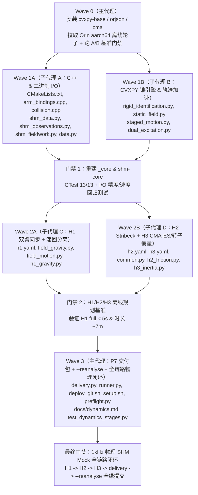

# 动力学标定全链路优化实施蓝图（外部库收敛 + 细化执行规范）

本蓝图作为长线与多子代理执行的**唯一权威规格书（Single Source of Truth）**。每个阶段均明确了**外部库替代方案、文件所有权、数学公式、数据结构、性能/精度基准门禁与回归测试**，确保多代理协作或长上下文切换时不丢失任何细节。

---

## 0. 全局基线与目标指标对照

> [!NOTE]
> 基线由 `main (a973464)` 在本机 Humble 容器（x86_64）实测得出；Orin（ARM Cortex-A78AE，离线运行于 `/home/nvidia/casbot_calib_shm`）单核耗时约为本机 2.5–3.5×。

| 指标 | 当前基线 (`a973464`) | 优化后目标 | 核心手段 |
| --- | ---: | ---: | --- |
| **H1 `full` 规划耗时** | **145.18 s**（Orin 约 7 min） | **< 4.0 s**（Orin < 10 s） | C++ OpenMP 批处理 + 静止段碰撞短路 + 闭合七次多项式极值 + 去重认证 |
| **H1 `full` 实机时长** | **1554.6 s（25.91 min）** | **~400 s（~6.7 min）** | 双臂块对角解耦同步配对 + 2-opt 姿态排序 + 正反接近姿态间直连 |
| **H1 `small` 实机时长** | **279.3 s（4.66 min）** | **~110 s（~1.8 min）** | 左右肩对称同步配对 + 正负目标直连 |
| **H2 `full` 实机时长** | **609.0 s（10.15 min）** | **~320 s（~5.3 min）** | 同关节跨速度连续扫掠 + 对数分布速度档 `[0.025..0.35] rad/s` |
| **`reference.json` 体积（H1 `full`）** | **50.72 MB** | **< 1.8 MB** | `orjson` 紧凑二进制序列化 + `5 ms` 步长与 `0.01 Nm` 量化死区去重 |
| **60 万帧采集后读取+汇总** | **30–90 s**（纯 Python `csv.DictReader`） | **< 0.25 s** | 统一声明式 NumPy 结构化 `dtype` 直读 `feedback.bin` / `commands.bin` |
| **刚体锥规划代码维护复杂度** | 90 行手工 `svec` / 稀疏块拼接 / 4 次启发式 IRLS | **~35 行声明式 LMI** | `cvxpy-base==1.7.5` (`cp.CLARABEL` + 原生凸 `cp.huber` + DPP 参数化正则扫描) |
| **H3 激励轨迹质量** | 固定随机相位、腕部加速度极弱、不含转子惯量 | **全局条件数优化 + 腕部分层高频 + 14 轴转子惯量** | `cma==4.5.0` (CMA-ES) 离线/规划期相位寻优 + 非负转子惯量锥联合辨识 |
| **现场免动重算与最终交付** | 无重算入口、结果散落各子目录 | **`--reanalyse` (< 2 s) + 自动防退化 + `delivery/`** | 会话级自动验收回退保护 + 一站式交付包 |

---

## 1. 外部库升级清单与 Orin `aarch64` 离线兼容性核验

已通过 PyPI 元数据实测核对 Python 3.10 (`cp310`) 在 **`x86_64` 与 `manylinux_2_28_aarch64`（Ubuntu 22.04 `glibc 2.35`）** 上的预编译二进制轮子可用性，**全部零源码编译风险、零冗余依赖**：

| 引入/启用外部库 | 精确版本与轮子形态 | 替代掉的仓库手写轮子 | 替换条件（Phase 0 基准门禁） |
| --- | --- | --- | --- |
| **`cvxpy-base`**（配合已有 `clarabel==0.11.1`） | `cvxpy-base==1.7.5`（官方无冗余求解器版，仅依赖已装的 `numpy`/`scipy`，`x86_64` & `aarch64` 均有 `cp310` 预编译 wheel） | 替代 [`rigid_identification.py`](../python/casbot_calib/rigid_identification.py) 中手工 $\sqrt{2}$ `svec` 打包、手工 `sparse.vstack` 锥索引拼接及 4 轮启发式 IRLS 循环 | QR 压缩后单次 `cp.huber` 求解 $< 100\text{ ms}$、DPP 扫描 6 组 `ridge` 总计 $< 250\text{ ms}$，且留出 RMSE 不劣于原实现 |
| **`orjson`** | `orjson==3.13.0`（零依赖 Rust SIMD 轮子，`cp310` `x86_64` & `aarch64` 预编译 wheel ~200 KB） | 替代 [`data.py`](../python/casbot_calib/data.py) 递归 `jsonable()`、[`shm_reference.py`](../python/casbot_calib/shm_reference.py) `save_bundle`、[`shm_fieldwork.py`](../python/casbot_calib/shm_fieldwork.py) `dump` 中的慢速 `.tolist()` 与 `json.dumps` | 原生支持 `OPT_SERIALIZE_NUMPY`、默认严格拒绝 `NaN/Inf`、序列化提速 $\ge 10\times$ |
| **`cma` (`pycma`)** | `cma==4.5.0`（纯 Python `py3-none-any.whl` ~80 KB，仅依赖 `numpy`） | 替代 [`dual_excitation.py`](../python/casbot_calib/dual_excitation.py) 的固定随机相位猜测 | 在 `ask()/tell()` 批量并行评估下使可观惯量回归阵条件数 $\kappa(W_{\text{obs}})$ 显著下降且满足连续碰撞门禁 |
| **GCC `OpenMP::OpenMP_CXX`** | 系统 GCC 11 内置（本机容器与 Orin 已自带 `omp.h` / `libgomp`，零新包） | 替代 [`arm_bindings.cpp`](../cpp/src/arm_bindings.cpp) 与 [`collision.cpp`](../cpp/src/collision.cpp) 的单线程串行批循环 | 多核数值与单线程逐元素误差 $< 10^{-14}$，批吞吐提升 $\ge 3\times$ |
| **`scipy.optimize` & `scipy.spatial.distance`** | 已装 `scipy==1.15.3` | 用 `least_squares(method='trf', loss='soft_l1')` 替代 H2 线性+单帧阈值拼凑；用 `cdist` + 2-opt 替代 H1 顺序往返锚点 | H2 留出集残差下降且参数满足 $0 \le f_c \le f_s$；H1 总路径关节行程缩短 $\ge 50\%$ |
| **NumPy 结构化二进制 `dtype`** | 已装 `numpy==1.26.4`（注：实测排除 `polars==2.1.0`，因其运行时轮子为 `cp311-abi3` 不支持 Orin Python 3.10；排除 `ruckig`/`toppra`，因缺少 `cp310 aarch64` 轮子） | 替代 [`shm_observations.py`](../python/casbot_calib/shm_observations.py) 与 [`shm_fieldwork.py`](../python/casbot_calib/shm_fieldwork.py) 中上百行手工字节偏移 `struct.unpack_from` 与百万行 `csv.DictReader` | 与原读取器在实测/Mock 数据上逐帧对比误差 $= 0$，读取提速 $\ge 200\times$ |

> [!WARNING]
> **Orin 离线部署保障（必做）**：Orin (`172.16.0.10`) 无外网，依靠离线 wheelhouse 安装 Python 依赖。新增上述 3 个轻量包（合计 `< 2 MB`）时，必须同步提供 `scripts/shm/fetch_wheels.sh` 在本机一键拉取 `manylinux2014_aarch64` / `manylinux_2_28_aarch64` + `x86_64` `cp310` 离线轮子到 `artifacts/wheelhouse_aarch64/`，并在 [`deploy_git.sh`](../scripts/shm/deploy_git.sh) 中自动把缺失 `.whl` 同步到 Orin 的 `artifacts/wheelhouse_aarch64/`（由 [`calib/setup.sh`](../calib/setup.sh) 自动发现安装）。

---

## 2. 必须全程死守的安全与工程不变量（Context Guardrails）

任何子代理修改任何文件时，严禁破坏以下底线（源自 [`AGENTS.md`](../AGENTS.md)）：
1. **安全门禁不打折**：
   - 正式标定段发送前必须通过 **Coal 连续碰撞检查（间距 $\ge 10\text{ mm}$）**、**URDF 连续位置包络（Bernstein 凸包）**、**连续速度包络（$\le \min(1.5\text{ rad/s}, v_{\text{urdf}})$）**；准备位前缀仅跳过碰撞，保留连续 URDF/速度检查。
   - 起点停稳检查（$|v| < 0.2\text{ rad/s}$）、零驱动错误码检查、C++ 侧使能前起点重读与限位复核、单 SHM owner 文件锁、`SIGINT/TERM/HUP` 失能等待 `disable_ack`、故障立即失能退出且不自动恢复。
2. **绝不重引入防御性仪式**：
   - 不加默认 dry-run、不加交互确认提示、不加必填 `--output`、不加 `manifest.json` 哈希封存、不加 `"not proof of..."` 免责字段。
3. **测试隔离**：
   - 所有自动化测试只连 `/casbot_calib_test_*` 私有端点，绝不触碰 `/shm_mc`。
4. **C++ 与绑定同步**：
   - 每次修改 `cpp/` 后，必须先重建 `.venv-humble` 的 `_core` Python 绑定与 `install/shm-core` C++ 可执行文件，再跑 `ctest` 与 `pytest`。

---

## 3. 分阶段详细实施规范（Phase 0 → Phase 4）

### Phase 0：外部库安装、离线 Wheelhouse 与 A/B 基准门禁

- **涉及文件**：
  - [`scripts/shm/requirements-shm.txt`](../scripts/shm/requirements-shm.txt)：新增 `cvxpy-base==1.7.5`、`orjson==3.13.0`、`cma==4.5.0`。
  - [`pyproject.toml`](../pyproject.toml)：同步运行依赖声明。
  - 新增 `scripts/shm/fetch_wheels.sh`：在本机使用 `pip download --only-binary=:all: --python-version 310` 为 `aarch64`（`manylinux2014_aarch64`、`manylinux_2_28_aarch64`、`any`）预拉取完整离线 wheelhouse 至 `artifacts/wheelhouse_aarch64/`。
  - [`scripts/shm/deploy_git.sh`](../scripts/shm/deploy_git.sh) & [`calib/setup.sh`](../calib/setup.sh)：若本机存在 `artifacts/wheelhouse_aarch64/`，部署时自动通过 SSH 同步至远端 `artifacts/wheelhouse_aarch64/`；更新 [`preflight.py`](../python/casbot_calib/pipeline/preflight.py) 检查 `cvxpy`、`orjson`、`cma`。
  - 跑 **CVXPY (`cp.CLARABEL`) vs 手写 `clarabel` IRLS** 及 **`orjson` vs `json.dumps`** A/B 对比基准，确认无性能/精度退化后进入 Phase 1–4。

---

### Phase 1：底层计算加速（C++ OpenMP）、二进制零拷贝 I/O 与 JSON 收敛

#### 1.1 C++ `_core` OpenMP 多核批处理
- **涉及文件**：
  - [`CMakeLists.txt`](../CMakeLists.txt)：`find_package(OpenMP QUIET)`；若找到则对 `calib_core` 和 `_core` 链接 `OpenMP::OpenMP_CXX`。
  - [`cpp/src/arm_bindings.cpp`](../cpp/src/arm_bindings.cpp)：
    - 在 `gravity_batch`、`evaluate_batch`、`regressor_batch`、`frame_batch`、`point_geometry_batch` 中，当 `count >= 16` 时使用 `#pragma omp parallel`，每个线程在并行区入口创建一次局部 `auto workspace = engine.workspace();`，内层 `#pragma omp for schedule(static)` 无锁写入各自 `row`。
  - [`cpp/src/collision.cpp`](../cpp/src/collision.cpp)：
    - 当前 `CollisionChecker::check_batch` 用 `std::lock_guard<std::mutex>` 锁死单个 `ArmWorkspace` 与单个 `std::vector<std::unique_ptr<coal::ComputeDistance>>`（`coal::ComputeDistance` 内部缓存 GJK 支撑点，非线程安全）。
    - **改造**：当 `positions.rows() >= 8` 时启用 OpenMP 并行区，每线程构造局部 `ArmWorkspace` 及轻量 `coal::ComputeDistance(shapes[a].get(), shapes[b].get())` 数组（`shapes` 为只读共享指针，线程安全），相邻姿态在同一线程内还能命中 GJK warm-start。

#### 1.2 规划期轨迹多项式与静止段碰撞短路
- **涉及文件**：
  - [`python/casbot_calib/static_field.py`](../python/casbot_calib/static_field.py)：
    - `_move()` 改为单位区间静止到静止七次 Hermite 插值 $s(u)=35u^4-84u^5+70u^6-20u^7$ 的精确解析导数峰值常数：
      $$c_1 = \frac{35}{16} = 2.1875,\quad c_2 = \frac{84}{5\sqrt{5}} \approx 7.5131884,\quad c_3 = \frac{105}{2} = 52.5$$
      直接由闭合公式 $T = \max\big(T_{\min},\ \max_{k\in\{1,2,3\}} (c_k \|\Delta q\|_\infty / L_k)^{1/k}\big)$ 一步计算段时长，零临时 `BPoly` 构造开销。
  - [`python/casbot_calib/staged_motion.py`](../python/casbot_calib/staged_motion.py)：
    - 在 `gate_motion` 中识别**纯静止保持段**（首末状态完全相等且 `allowance is None`）：若缓存已认证同一 $q_i$ 间距 $> \text{clearance}$，直接 $O(1)$ 复用距离结果生成连续证明；否则仅查单点 `profile.check(q_i[None, :])`。
    - 对多个运动段先将初始区间中点合并成单次批量 `profile.check` 调用，充分利用 C++ OpenMP 多核吞吐。

#### 1.3 `orjson` 统一序列化与前馈表紧凑化
- **涉及文件**：
  - [`python/casbot_calib/data.py`](../python/casbot_calib/data.py)、[`shm_reference.py`](../python/casbot_calib/shm_reference.py)、[`shm_fieldwork.py`](../python/casbot_calib/shm_fieldwork.py)：
    - 用 `orjson.dumps` (`OPT_SERIALIZE_NUMPY`) 替代递归 `jsonable` + `json.dumps`（小配置文件保留 2 空格可读缩进；大体积 `reference.json` / `motion.json` 使用紧凑无缩进输出 + `.tmp` 原子替换）。
  - [`python/casbot_calib/stages/dynamics/common.py`](../python/casbot_calib/stages/dynamics/common.py) & [`h1_gravity.py`](../python/casbot_calib/stages/dynamics/h1_gravity.py)：
    - 统一收敛为 `build_feedforward_effort_rows(motion, engine, robot_config, preparation_cert=None, *, mode='gravity', step_ns=5_000_000)`：默认以 `5 ms` 步长（包含首尾精确时刻）评估前馈并按驱动 `0.01 Nm` 量化码去重，使 `H1 full` 的 `reference.json` 从 `50.7 MB` 降至 `< 1.8 MB`。

#### 1.4 声明式 NumPy 二进制帧解码（替代 `csv.DictReader` 与魔法字节偏移）
- **涉及文件**：
  - [`python/casbot_calib/shm_data.py`](../python/casbot_calib/shm_data.py)：定义与 [`wire35.hpp`](../cpp/include/casbot_calib/shm/wire35.hpp) 严格字节对齐的结构化 `np.dtype`（`JOINT_STATUS_DTYPE` `16 B`、`HAND_STATUS_DTYPE` `52 B`、`STATUS_FRAME_DTYPE` `696 B`、`FEEDBACK_RECORD_DTYPE` `704 B`、`COMMAND_RECORD_DTYPE` `752 B`）。
  - [`python/casbot_calib/shm_observations.py`](../python/casbot_calib/shm_observations.py)：
    - 新增向量化 `ObservationReader.arrays()`（`.rows()` 基于其迭代保持向后兼容），优先 `np.fromfile(root / 'feedback.bin', dtype=FEEDBACK_RECORD_DTYPE)` 零拷贝读取，向量化完成 `clock_pairs.csv` 时间映射与 `events.csv` 阶段重建；仅当无 `feedback.bin` 时回退 CSV。
  - [`python/casbot_calib/shm_fieldwork.py`](../python/casbot_calib/shm_fieldwork.py)：
    - `summarize_feedback`、`summarize_commands`、`timing_summary` 全部改为向量化二进制数组统计。

---

### Phase 2：H1 静态重力算法重构与双臂同步直连轨迹

#### 2.1 `cvxpy-base` 统一刚体锥规划引擎（含精确 `cp.huber` 与 DPP 正则扫描）
- **涉及文件**：[`python/casbot_calib/rigid_identification.py`](../python/casbot_calib/rigid_identification.py)
- **设计细节**：
  - 保留 `fit_rigid(...)` 原有函数签名与返回字典字段兼容，新增可选参数 `ridge_grid=None, validation_data=None`；
  - 使用 `cvxpy` 建立问题：
    - 决策变量 $x \in \mathbb{R}^{140 + m}$，物理参数 $\theta = \theta_0 + S x$；
    - 对每个连杆 $k \in \{0..13\}$，4×4 伪惯量对称矩阵线性映射 $C J(\theta_k) C \succeq \varepsilon I_4$（`>> eps * np.eye(4)`）；
    - `auxiliary` 上下界约束 `lower <= theta_aux <= upper`；`equalities` 满秩 SVD 约束 `V_r @ x == rhs_eq`；
    - 数据损失：原生凸 `cp.sum(cp.huber(...))`（或 QR 压缩 `cp.sum_squares`），由 `cp.CLARABEL` 单次内点法求精确全局最优；
    - 正则项 $\frac{1}{2} \lambda \|x\|_M^2$ 使用 `cp.Parameter(nonneg=True)`，支持 DPP 快速扫描 `ridge_grid` 并基于留出集 RMSE 与单轴防退化规则选出最优 $\lambda^*$。

#### 2.2 H1 真实位置配对滞回分离（解决实机 `1.6°–2.4°` 位置差与死区偏置）
- **涉及文件**：[`python/casbot_calib/field_gravity.py`](../python/casbot_calib/field_gravity.py) & [`h1_gravity.py`](../python/casbot_calib/stages/dynamics/h1_gravity.py)
- **数学模型**：
  - 保留每个可用静态窗口 $w$ 在其实测平均角 $\bar q_w$ 处的精确回归阵 $Y(\bar q_w) \in \mathbb{R}^{14 \times 140}$；
  - 读取实测 `ApproachDisplacement` $\Delta q_{\text{obs}, w}$：若 $|\Delta q_{\text{obs}, w, j}| \ge 0.3^\circ$，方向符号 $s_{w,j} = -\operatorname{sign}(\Delta q_{\text{obs}, w, j})$；若 $< 0.3^\circ$（死区卡滞），标记 `deadband_stuck=True`、令 $s_{w,j} = 0$ 并降权 `0.5`；
  - 将 14 轴静态滞回幅值 $c \in [0, 3.0]^{14}\text{ Nm}$ 作为 `fit_rigid` 的 `auxiliary` 变量联合求解：
    $$Y(\bar q_w)\theta + \operatorname{diag}(s_w)\, c \approx \bar\tau_w$$
  - 配合 `ridge_grid=[1e-5, 1e-4, 1e-3, 1e-2, 1e-1, 5e-1]` 在留出验证集上自动选优 $\lambda^*$。

#### 2.3 H1 双臂同步配对 + 2-opt 姿态间直连编排
- **涉及文件**：[`configs/dynamics/h1.yaml`](../configs/dynamics/h1.yaml)、[`h1_gravity.py`](../python/casbot_calib/stages/dynamics/h1_gravity.py)、[`field_motion.py`](../python/casbot_calib/field_motion.py)
- **轨迹设计**：
  - `h1.yaml`：`full.approach_offset_deg: 5.0`；默认启用 `parallel_arms: true` 与 `direct_pose_chain: true`。
  - 同 split 内将左臂 D-optimal 姿态与右臂姿态合成为双臂同步姿态（预筛碰撞间距 $< 12\text{ mm}$ 则同 split 换配对或回退单臂）；
  - 用 `scipy.spatial.distance.cdist` 切比雪夫距离 + 最近邻与 2-opt 局部搜索排序姿态，按 `anchor -> [pose_k: near_- -> q -> settle -> measure -> near_+ -> q -> settle -> measure] -> ... -> anchor` 直接串联（若个别跨姿态直连 `< 10 mm` 则仅在该段插入经 `home` 中转）。

---

### Phase 3：H2 同构 Stribeck 摩擦与 H3 CMA-ES 最优激励 + 转子惯量联合辨识

#### 3.1 H2 对数速度档、连续扫掠编排与 C++ 同构 Stribeck 曲线拟合
- **涉及文件**：[`configs/dynamics/h2.yaml`](../configs/dynamics/h2.yaml)、[`h2_friction.py`](../python/casbot_calib/stages/dynamics/h2_friction.py)
- **改造内容**：
  - `h2.yaml` `full` 速度档改为对数分布 `train: [0.025, 0.08, 0.20, 0.35]`、`validation: [0.05, 0.14, 0.28]`，`stroke_half_deg: 8.0`；循环顺序改为 `split -> pose_offset -> group -> speed`；
  - 用 `scipy.optimize.least_squares`（`method='trf'`, `loss='soft_l1'`, 解析雅可比）在与 [`arm_dynamics.cpp`](../cpp/src/arm_dynamics.cpp) 完全同构的模型 $\hat\tau_f(v) = b v + (f_c + \Delta f_s e^{-(v/v_s)^2})\tanh(v / v_0)$ 上联合拟合平台段与加减速过渡段，并输出正反半和残余力矩零偏诊断 `torque_offset_diagnostic_nm`。

#### 3.2 H3 腕部分层高频 + `cma` (CMA-ES) D-Optimal 激励合成 + 转子惯量联合辨识
- **涉及文件**：[`configs/dynamics/h3.yaml`](../configs/dynamics/h3.yaml)、[`dual_excitation.py`](../python/casbot_calib/dual_excitation.py)、[`h3_inertia.py`](../python/casbot_calib/stages/dynamics/h3_inertia.py)、[`common.py`](../python/casbot_calib/stages/dynamics/common.py)
- **改造内容**：
  - **关节带宽分层谐波**：肩肘近端轴谐波 `train [1,2,3,5]` / `val [1,3,4,6]`；前臂与腕部远端轴谐波 `train [2,4,6,9]` / `val [2,5,7,10]`，大幅提升腕部角加速度信噪比；
  - **`cma` (CMA-ES) 相位寻优**：每轮 `es.ask()` 种群合并为单次 C++ OpenMP 回归阵与碰撞批量查询，最小化可观惯量子空间条件数对数并惩罚限位/碰撞越界，最终仍由 `compose_stage_reference` 执行严格连续碰撞认证；
  - **平滑重力+摩擦前馈**：`h3.yaml` 默认启用平滑先验重力 + 粘性/软库仑前馈，减小低增益动态相位滞后；
  - **14 轴转子反射惯量（`rotor_inertia`）联合辨识**：将带限加速度对角块作为 `auxiliary` 非负锥变量与 140 维连杆刚体参数在 `fit_rigid` 中联合求解（冻结 H1 静态重力子空间），结果同步导出至 `runtime_dynamics.json` 与候选模型。

---

### Phase 4：现场免动重分析（`--reanalyse`）、自动防退化门禁与 P7 `delivery/` 交付包

- **涉及文件**：新增 `python/casbot_calib/pipeline/delivery.py`、[`runner.py`](../python/casbot_calib/pipeline/runner.py)、[`common.py`](../python/casbot_calib/stages/dynamics/common.py)、[`docs/dynamics.md`](dynamics.md)
- **改造内容**：
  1. **`--reanalyse [SESSION_DIR]`**：所有 `calib/dynamics*.sh` 支持免接管、免动机器直接对已有 `capture/` 秒级重跑辨识与报告打包（旧 `analysis/` 自动归档为 `analysis.previous_<ns>`）。
  2. **自动防退化门禁（Non-Regression Gate）**：每阶段输出 `acceptance` 判定；若留出集未改善或主激励轴显著退化，标记 `accepted=False`，下游先验解析与最终交付自动回退至未退化的上游先验参数。
  3. **会话级 `delivery/` 交付包**：自动汇总生成 `calibrated.urdf`、`runtime_dynamics.json`、`calibration_bundle.json` 与中文一页纸验收总表 `summary.md`。

---

## 4. 多子代理长线执行编排方案（防冲突、防丢上下文）

---

## 5. 执行进度追踪表

- [ ] **Wave 0**：依赖安装（`cvxpy-base==1.7.5`, `orjson==3.13.0`, `cma==4.5.0`）、Orin `aarch64` 离线轮子准备与 A/B 性能基准验证
- [ ] **Wave 1A**：C++ `_core` OpenMP 并行批处理 + NumPy 结构化二进制帧直读 + `orjson` 紧凑序列化
- [ ] **Wave 1B**：`cvxpy-base` (`cp.CLARABEL` + `cp.huber` + DPP `ridge` 扫描) 重构 `rigid_identification.py` + 静止段碰撞短路 + CMA-ES 激励相位寻优器
- [ ] **Wave 2A**：H1 `full` 5° 接近修复 + 精确位置配对滞回分离 + 双臂同步配对与 2-opt 姿态直连
- [ ] **Wave 2B**：H2 对数速度连续扫掠 + C++ 同构 Stribeck 拟合 + H3 腕部分层高频 / 平滑重力摩擦前馈 / 14 轴转子惯量联合辨识
- [ ] **Wave 3**：`--reanalyse` 免动秒级重算 + 自动防退化验收门禁 + 会话级 `delivery/` 统一交付包 + 全量 CTest/Pytest 闭环验收与文档更新
