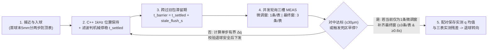
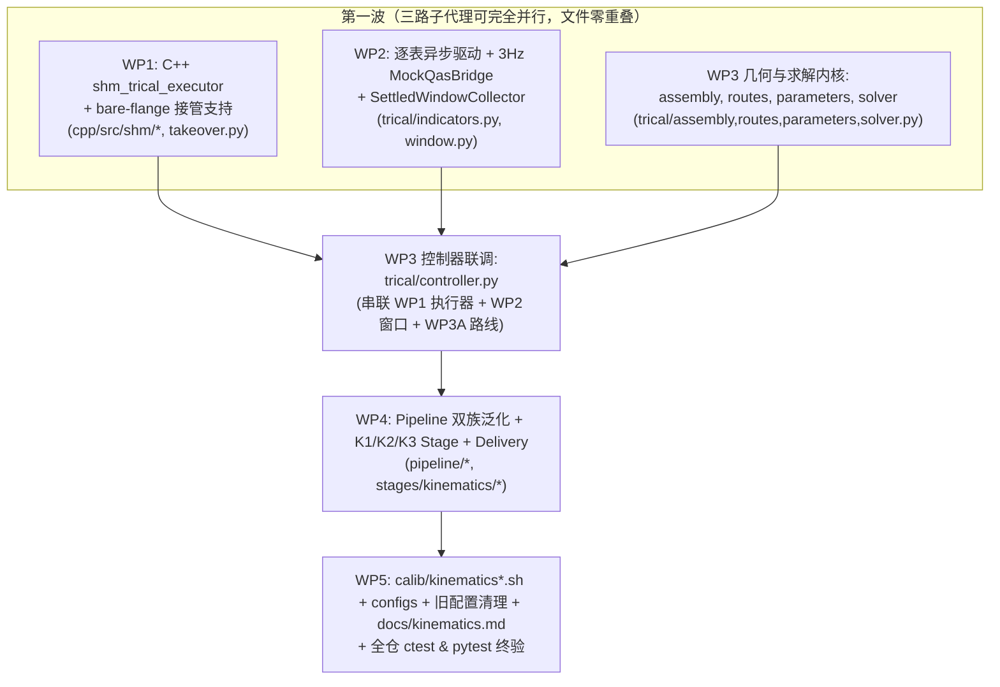

# 双臂运动学标定（K1–K3）工作区重构与 3Hz 低频千分计适配实施蓝图

本蓝图作为后续长线执行与多子代理协作的**唯一权威规格书（Single Source of Truth）**。文档完整定义了阶段重构设计、工作区目录收敛、3 Hz 低频 QAS 千分计准静态计量协议、低增益防蓄能安全边界、C++/Python 接口契约、子代理工作包（WP1–WP5）拆分及验收门禁。

---

## 0. 重构背景与核心决策总览

### 0.1 为什么推翻旧 `ros` 分支的 `K1–K5` 划分？
旧 `ros` 分支中的 `K1–K5` 是研发期的历史里程碑编号（`K1` 数据格式、`K2` 模拟器对中、`K3` 离线仿真辨识、`K4` 三批噪声复测与 MuJoCo 视频渲染、`K5` ROS 2 SDK 500Hz 假表试验），并非现场标定工序；同时在 `python/casbot_calib/` 顶层平铺了 25+ 个脚本文件，充斥 `synthetic_only=True` 死锁、SHA256 摘要封条、搬移 `evaluation/` 目录等防御性代码。

当前 `main` 分支已完成双臂动力学 `H1 → H2 → H3` 在 Orin 原生 1 kHz EtherCAT SHM（`/shm_mc`）上的闭环重构，且保留了运动学最核心的重资产：
- **C++ 三表几何投影底座**：[`cpp/include/casbot_calib/trical.hpp`](../cpp/include/casbot_calib/trical.hpp)、[`cpp/src/trical.cpp`](../cpp/src/trical.cpp)
- **DVT2 `1105_03` 四球台架与单工装 CAD 凸包资产**：[`python/casbot_calib/trical_assembly.py`](../python/casbot_calib/trical_assembly.py)、`assets/models/trical_1105_03*`、`assets/trical_1105_release_turn_reference.json`、`derived/bare_flange_1105_03_gauge_v2`
- **BLE–USB 桥接固件与主机协议工具**：[`firmware/trical_bridge/`](../firmware/trical_bridge)（Zephyr CDC ACM JSONL）与 [`firmware/tools/trical_usb.py`](../firmware/tools/trical_usb.py)
- **统一流水线与交付底座**：[`python/casbot_calib/pipeline/`](../python/casbot_calib/pipeline)

### 0.2 定型后的 `K1 → K2 → K3` 产线三阶段流程
结合 `1105_03` 物理装配事实（**拆双手裸法兰运行，现场仅 1 套物理三轴千分计工装，先测左臂再换装测右臂**）以及 [`AGENTS.md`](../AGENTS.md) **不在代码内加交互确认框**的准则，运动学定型为与 `H1 → H2 → H3` 完全对称的固定三阶段：

| 阶段 | 脚本入口 | 物理挂载与运行性质 | 核心动作与阶段产出 |
| :--- | :--- | :--- | :--- |
| **K1：左臂触球采集**<br/>(`k1`) | `calib/kinematics_k1.sh` | 工装装**左腕法兰**（右臂裸法兰停安全位），三表已对标准球清零。<br/>`execution_kind = 'interactive'` | 支持 `--mode smoke`（仅 A 球单点往返对中冒烟）/ `small`（四球各 1 姿态快速零位检）/ `full`（四球 A/B/C/D 训练+留出多姿态）。1 kHz SHM 持续保持 + 3 Hz 问答读表 + 雅可比有界微调对中 + 静止窗口采样 + 先退后转回位失能。输出 `k1/report.md`（各球残差、读表极差、左臂 7 轴零偏初检）。结束后自动失能，操作员拆表换装右腕（**全流程仅拆装 1 次，零交互弹窗**）。 |
| **K2：右臂触球采集**<br/>(`k2`) | `calib/kinematics_k2.sh` | 工装换装至**右腕法兰**（左臂裸法兰停安全位）。<br/>`execution_kind = 'interactive'` | 自动续接当前机器的运动学会话，完成右臂四球 A/B/C/D 闭环对中采样并回位失能。输出 `k2/report.md`（右臂各球残差、右臂 7 轴零偏初检）。 |
| **K3：双臂联合辨识与交付**<br/>(`k3`) | `calib/kinematics_k3.sh` | **纯离线阶段（免接管、免动机器人）**，也可紧随 K2 自动串联执行。<br/>`execution_kind = 'offline'` | 汇集 K1 + K2 在**同一四球基准台架**下的全部静止窗口实测残差（不假定对中误差为 0），执行两层求解：<br/>1. **零位与台架自检层**：求 14 轴有效零偏，并利用双臂共测四球的几何冗余交叉诊断球架摆放位姿误差；<br/>2. **连杆几何层**：Pinocchio C++ 运动学回归量 + 列主元 QR 条件数选参（$\kappa \le 200$）+ SciPy 有界 TRF `soft_l1` 拟合；<br/>3. 留出姿态三维球心残差 RMSE 防退化门禁，生成 `k3/report.md` 与会话级 `delivery/`。 |

**典型运行方式**：
```bash
# 现场单工装标准两步流（换装 1 次，代码内无阻塞确认）：
bash calib/kinematics_k1.sh --robot DVT2_01 --mode full     # 1. 左腕挂表测完自动失能
bash calib/kinematics.sh --resume                           # 2. 换装右腕后一键跑完 K2 -> K3 -> delivery

# 离线规划检查 / 免动重算 / 私有 Mock 全流程（3Hz 低频替身）：
bash calib/kinematics.sh --plan-only
bash calib/kinematics.sh --reanalyse
bash calib/dev.sh kinematics-mock --mode small
```

---

## 1. 必须死守的安全红线与反防御性准则（Context Guardrails）

任何子代理修改任何代码时，必须严格遵守 [`AGENTS.md`](../AGENTS.md) 规范：

1. **内部自动安全门禁一处不减**：
   - 自由空间保持 `>= 10 mm` 连续 Coal 余量；接触段仅允许当前工装 3 个具名测头薄片与目标球进入 `[-5 mm, 0 mm]` 行程、登记近接对 `>= 2 mm`、其余全部 `>= 10 mm`，接触区姿态偏差锁定 `<= 1°`；跨侧球（左 D、右 C 等）必须 3 测头全部退出至 `>= +0.5 mm` 正间隙（`released` 阶段）才允许转向。
   - 每次在线雅可比微调段下发前，必须实时证明**微调段本身 + 从新目标点退回接触种子的退球路径**满足接触碰撞与姿态门禁。
   - 起点停稳检查（`< 0.2 rad/s`）、零驱动故障码检查、C++ 侧使能前起点重读复核、单 SHM owner 锁、`SIGINT/TERM/HUP` 及管道断开立即转失能并等待 `0x21` 应答、驱动/通信/超差故障立即失能中止会话且不自动恢复。
2. **严禁针对低频表做边走边探或无上限叠步（防顶爆千分计）**：
   - 3 Hz~30 Hz 千分计绝对不承担运动中的防撞保护；所有位移均是有界静止到静止 C3 段。
   - 必须实施**实测角锚定防蓄能（Anti-Windup）保护**（详见第 2.4 节），严禁在谐波减速器静摩擦死区内无上限累加指令角 `q_cmd`。
3. **彻底清除防御性设计**：
   - **不搬回** `ros` 分支的 MuJoCo 视频渲染（`kinematic_presentation.py`）、三批重复噪声验收（`kinematic_acceptance.py`）、`manifest.json` SHA256 文件封存、`evaluation/` 目录搬进搬出戏码。
   - **不写** `"synthetic_only": true`、`"hardware_executable": false`、`"not proof of..."` 等免责声明字段；不加命令行交互确认；不要求必填 `--output`。
4. **测试环境隔离**：
   - 自动化测试只允许连接 `/casbot_calib_test_*` 私有 SHM 端点与本地 `MockQasBridge`，严禁触碰 `/shm_mc` 或真实串口。
   - 经 `scripts/humble/container.sh` 运行命令必须重定向 `< /dev/null`；修改 `cpp/` 后必须先重编 `_core` 绑定与 `install/shm-core` 再跑 `ctest` 与 `pytest`。

---

## 2. 低频（3 Hz 基线）千分计计量协议与实机适配规范

### 2.1 硬件通信事实与固定轮询模式
依据 [`firmware/docs/qas_usb.md`](../firmware/docs/qas_usb.md) 与逆向实测记录：
- 物理链路为：`三只 QAS 千分计 -> BLE GATT -> Pro Micro nRF52840 (trical_bridge) -> USB CDC ACM (JSONL) -> Orin`。CDC ACM 数据面本身运行在 USB Bulk 端点上，直接复用现有 JSONL 行协议，不重写自定义 USB 驱动。
- QAS 自动上报模式可能仅在读数变化时触发，而**主动发送 `MEAS` 命令在数值不变时也会返回测量通知**（单表 250 ms 请求间隔下实测约 `3.2~3.7 Hz`）。
- **架构拍板**：第一版直接以**“每表 ~3 Hz、`MOD:0` + 主动定时请求 `MEAS`”**作为基线设计；未来提频至 10~30 Hz 仅自然缩短收数等待，零架构改动。

### 2.2 逐表异步事件模型与双钟域隔离
QAS 协议**无仪表内部 ADC 采样时间戳、无原生帧序号**。底层驱动严禁拍扁为 `read_latest() -> float[3]`，必须保留逐表事件结构 `IndicatorEvent`：

```python
@dataclass(frozen=True)
class IndicatorEvent:
    slot: int                    # 0, 1, 2
    axis: str                    # 显式绑定的工装测量轴 'x' | 'y' | 'z'（绝不按扫描顺序猜测）
    reading_m: float             # 按显式符号与单位换算后的米制读数（status != 0 时为 nan）
    status: int                  # 0=VALID, 1=NO_CONTACT, 2=OUT_OF_RANGE, 3=FROZEN/INVALID, 4=DISCONNECTED
    epoch: int                   # 桥端连接轮次
    bridge_seq: int              # 桥端本地事件计数
    bridge_time_us: int          # nRF52840 单调接收时刻（独立 MCU 钟域，严禁与 Orin 时间相减！）
    host_receive_ns: int         # Orin time.monotonic_ns()（与 C++ SHM Recorder 同一 CLOCK_MONOTONIC 钟域）
    sample_ns: int | None = None # 真实采样时刻：QAS 实表与 3Hz 默认 Mock 固定为 None
```
- **相同读数保留**：连续两次通知数值完全相等属于静止测量的正常现象，照常作为新通知计入窗口，但不宣称表内发生了独立重采样。
- **连接轮次校验**：采集期间若任一槽发生断连或 `epoch` 跳变，立即按仪表通信故障中止当前阶段并失能退出。

### 2.3 “移动 $\rightarrow$ 1kHz 判停 $\rightarrow$ 旧包隔离 $\rightarrow$ 分槽收数”单点闭环状态机
淘汰旧配置 [`trical_capture_defaults.json`](../python/casbot_calib/assets/trical_capture_defaults.json) 中针对 50 Hz 合成表编写的时间条件（`140 ms` 凑 6 帧、`65 ms` 超时、`0.5 mrad/s` 无噪速度阈值）。K1/K2 每个测点按以下步骤执行：



关键参数默认值（写入 `configs/kinematics/k{1,2}.yaml`，全部支持现场按实测调优）：
1. **1 kHz 机械停稳判据（适配实机编码器底噪与未完全刚性基座）**：
   - C++ 执行器段走完进入 `hold` 后，对最近 `arm_settle_window_s = 0.20 s`（200 帧 1 kHz 反馈）计算 10 ms 均值滤波后的关节轨迹：要求 14 轴最大位置峰峰值 `ptp(q_filt) <= 0.25 mrad` 且最大滤波速度 `|dq_filt| <= 4.0 mrad/s`，满足瞬间记 Orin 单调时钟为 `t_settled_ns`。若 `settle_timeout_s = 3.0 s` 内未停稳则报错失能。
2. **旧数据滞留隔离（Causality Flush Barrier）**：
   - 清空队列清不掉表内 ADC 与 BLE 空口在途旧包。严格等待至 `t_barrier_ns = t_settled_ns + stale_flush_ns`（默认 `stale_flush_s = 0.35 s`）后，才向三槽发起本轮 `MEAS` 轮询（轮询节拍 `poll_interval_s = 0.25 s`，单槽最多 1 条在途请求，遇 `-EBUSY` 跳过本拍不报错）。
   - 任何 `host_receive_ns < t_barrier_ns` 的迟到通知一律标记为 `stale_pre_barrier` 丢弃，绝不进入微调或辨识窗口。
3. **微调短窗口 vs 最终入库窗口分离（兼顾 3 Hz 节拍与抗跳字）**：
   - **微调决策窗口（Centering Window）**：`t_barrier_ns` 之后每槽收齐 **`min_centering_samples = 1` 条** `VALID` 通知即可计算雅可比修正步 $\Delta q$；每次发出微调必须作废旧窗口，严禁同一批读数重复驱动两次微调。
   - **最终测量窗口（Final Acceptance Window）**：当偏差进入 `centering_tolerance_m = 30e-6`（30 µm）后，`t_barrier_ns` 之后每槽独立收齐 **`min_final_samples = 3` 条** `VALID` 通知，且满足：
     - 窗口时间跨度 `t_last - t_barrier >= min_final_duration_s`（默认 `0.60 s`）；
     - 每槽读数极差 `ptp(z_slot) <= stable_indicator_span_m`（默认 `5e-6`，即 5 µm）；
     - 整个收数区间 `[t_barrier_ns, t_last_ns]` 内 C++ 1 kHz 关节反馈持续满足静止包络（无漂移超限）；
     - 单点单轮收数总超时 `window_timeout_s = 6.0 s`（即使三表并发掉到 1.5 Hz 也绰绰有余；若单表停更超时则中止会话并失能，绝不无限期保持）。
   - **实测残差直传 K3**：保存 `[t_barrier_ns, t_last_ns]` 内 1 kHz 实测关节角均值 $\bar{q}_{\text{obs}}$ 与各槽读数均值 $\bar{z}$，K3 直接由 $d_{\text{sensor}} = A^{-1}(\bar{z} - z_{\text{center}})$ 代入残差方程，绝不把“进入 30 µm 阈值”当成球心零残差。

### 2.4 低增益（`kp=20~65`）与谐波静摩擦死区下的重力前馈与防蓄能窜动（Anti-Windup）
实机当前增益为 `kp=[65, 65, 30, 30, 30, 20, 20]`（见 [`configs/robot/dvt2.yaml`](../configs/robot/dvt2.yaml)），主机不自动补重力，且谐波减速器存在 `0.5~0.9 Nm` 静摩擦死区：
1. **C++ 1 kHz 实时重力前馈**：
   - 执行器自动加载同机器最新通过验收的 H1 重力模型（若无则回退名义 URDF 刚体参数 + 可配置的千分计工装附加质量 `tool_mass_kg` / `tool_com_m`），在 1 kHz 循环中按当前参考角实时叠加 `effort = effort_gain * g(q_ref)`。
2. **指令-实测最大弹簧蓄能硬限幅（防止突破静摩擦猛冲顶表）**：
   - 在接触微调阶段，若关节卡在静摩擦死区内不动而控制器一轮轮累加 `q_cmd`，一旦弹性力矩 $k_p (q_{\text{cmd}} - q_{\text{obs}})$ 越过静摩擦阈值，末端会瞬间弹射数毫米顶坏千分计！
   - **双重硬约束**：
     - Python 对中器与 C++ 执行器同时强制校验接触段 **`|q_to[j] - q_obs_settled[j]| <= max_spring_windup_rad`**（默认 `0.012 rad` $\approx 0.69^\circ$，对应腕部 $< 0.25\text{ Nm}$、肩部 $< 0.78\text{ Nm}$，物理上限制最大释放能量）；
     - **死区停滞早停采纳**：若上一轮微调指令步幅 $\|\Delta q_{\text{cmd}}\|_\infty > 0.1\text{ mrad}$，但停稳后实测关节位移 $\|\Delta q_{\text{obs}}\|_\infty < 0.05\text{ mrad}$（已被静摩擦锁死），且当前三表解算球心偏移 $\|d_{\text{sensor}}\|_2 \le \text{deadband\_accept\_tolerance\_m}$（默认 `80e-6` m，完全处于半径 2 mm 平面测头中心有效区内），**立即停止微调并转入最终测量窗口采样入库**，绝不与静摩擦死磕！
3. **首球两步试探入球（防未标定大零偏顶底）**：
   - 在 `smoke` 模式及 K1/K2 每臂第 1 个访问测点入球时，在距离最终接触种子后退 `2.5 mm` 的中间点先停稳做 1 次 `1 条/表` 快速读表检查：确认未超量程且估算终点压缩量安全后，再走完最后 `2.5 mm`。

---

## 3. 目标工作区结构与清理清单

### 3.1 目标目录树
```text
calib/
├── dynamics.sh / dynamics_h{1,2,3}.sh       # 现有动力学入口（保持不变）
├── kinematics.sh                            # 新增：运动学全流程入口 (--stages k1,k2,k3)
├── kinematics_k1.sh                         # 新增：K1 左臂触球采集 (--stages k1)
├── kinematics_k2.sh                         # 新增：K2 右臂触球采集 (--stages k2，无参时自动续接同机器待完结 K 会话)
├── kinematics_k3.sh                         # 新增：K3 双臂联合辨识与交付 (--stages k3)
├── dev.sh                                   # 扩展：增加 trical-probe（单表/三表串口联调）与 kinematics-mock
├── gui.sh / setup.sh

configs/
├── robot/dvt2.yaml                          # 公共机器人配置
├── dynamics/{h1,h2,h3}.yaml                 # 现有动力学配方
├── kinematics/                              # 新增：运动学配方目录
│   ├── k1.yaml                              # 左臂选点配额、低频窗口阈值、三表轴向与零点默认配置
│   ├── k2.yaml                              # 右臂选点配额与窗口配置
│   └── k3.yaml                              # 两层辨识条件数上限 (<=200)、尺度、留出门禁阈值
└── shm/
    ├── h1_mock.json
    └── k_mock.json                          # 新增：裸法兰 SHM Mock + 3Hz QAS 延迟/偏置配置

cpp/
├── include/casbot_calib/trical.hpp          # 保留：C++ 三表正逆投影核心
├── src/shm/
│   ├── CMakeLists.txt                       # 注册 shm_trical_executor 及测试
│   ├── field_runtime.cpp                    # 增加 --bare-flange（免灵巧手背景帧）支持
│   ├── trical_runtime.hpp                   # 新增：1kHz 分段保持 + 实时重力前馈 + 滑窗停稳执行器声明
│   └── trical_runtime.cpp                   # 新增：stdin/stdout JSONL 分段流执行器实现
└── tools/shm_trical_executor.cpp            # 新增：薄 main 入口

python/casbot_calib/
├── pipeline/                                # 泛化支持 dynamics 与 kinematics 双族
│   ├── stage.py                             # 扩展 execution_kind / family / requires_hand_background
│   ├── session.py                           # 增加 family 标记与 latest_dynamics / latest_kinematics 软链
│   ├── takeover.py                          # 支持 bare_flange=True 免手部背景帧接管
│   ├── native.py                            # 增加交互式分段执行监管包装与裸法兰快照
│   ├── runner.py                            # 统一编排 reference / interactive / offline 三种阶段
│   └── delivery.py                          # 增加运动学交付包生成与 K <-> H 模型参数双向继承
├── trical/                                  # 新增：运动学核心算法与硬件抽象子包（替代旧平铺模块）
│   ├── __init__.py
│   ├── assembly.py                          # 迁入并清理 trical_assembly.py（1105_03 四球/工装碰撞配置）
│   ├── indicators.py                        # IndicatorEvent / UsbBridgeIndicatorDriver / MockQasBridge
│   ├── window.py                            # SettledWindowCollector（停稳判据 + 旧包隔离 + 1/3条双窗口）
│   ├── routes.py                            # 进退路线分段门禁、1°姿态锁、先退后转、D-optimal 姿态选点
│   ├── controller.py                        # SHM 分段执行客户端 + 单点自动对中与防蓄能状态机
│   ├── parameters.py                        # 60 维 Craig MDH/Hayati 参数图与 Pinocchio C++ 回归量封装
│   └── solver.py                            # 双臂联合两层求解器、台架自检、URDF 导出与重加载校验
└── stages/
    ├── dynamics/{common,h1,h2,h3}.py        # 现有动力学阶段
    └── kinematics/                          # 新增：运动学三阶段实现
        ├── __init__.py
        ├── common.py
        ├── k1_left.py
        ├── k2_right.py
        └── k3_identify.py

docs/
├── dynamics.md                              # 现有动力学操作手册
├── kinematics.md                            # 新增：运动学现场操作手册（装表清零 -> K1 -> 换装 -> K2/K3 -> 看结果）
└── kinematics_refactoring_plan.md           # 本蓝图
```

### 3.2 旧残留文件清理与去防御化清单
- **删除过时顶层配置**（确认无现行测试引用后移除，若有旧测试引用则同步迁移测试至新配置）：
  - `configs/kinematics_trical.yaml`、`configs/staged_dual_arm.yaml`、`configs/static_field_nominal.yaml`、`configs/dvt2_model_candidate.yaml` 及 `configs/dvt2/` 下不再使用的过渡文件。
- **解除模型上下文死锁**：
  - 清理 [`python/casbot_calib/kinematics.py`](../python/casbot_calib/kinematics.py) 与 [`python/casbot_calib/model_context.py`](../python/casbot_calib/model_context.py) 中的 `synthetic_only=True`、`hardware_executable=False` 拦截逻辑及免责字符串；将 `trical_assembly.py` 迁入 `trical/assembly.py`（顶层保留薄重导出兼容现有测试，待全部测试迁移后可删）。

---

## 4. 子代理工作包详细规范（WP1 → WP5）

### WP1：C++ 1kHz 分段保持执行器与裸法兰支持
- **负责文件**：
  - `cpp/src/shm/field_runtime.cpp`、`cpp/src/shm/trical_runtime.{hpp,cpp}`、`cpp/tools/shm_trical_executor.cpp`、`cpp/src/shm/CMakeLists.txt`、`cpp/tests/shm_trical_tests.cpp`
  - `python/casbot_calib/pipeline/takeover.py`、`calib/setup.sh`（预检二进制列表补充 `shm_trical_executor`）
- **具体规格**：
  1. **裸法兰支持（`--bare-flange`）**：
     - `field_runtime.cpp` 与 `trical_runtime.cpp` 支持 `--bare-flange`（与 `--hand-background` 二选一）：开启后构造零初始化的 744 字节 `CommandFrame`（`hand_count = 0`），不要求提供灵巧手快照；
     - `takeover.py` 的 `ensure_ready_channel(..., require_hand_background=True)` 在 `require_hand_background=False` 时跳过 `hand_background.bin` 缺失报错。
  2. **`shm_trical_executor` 实时协议与 1 kHz 主循环（参考 [`gui_runtime.cpp`](../cpp/src/shm/gui_runtime.cpp) 的双线程无锁 IO 模式）**：
     - 启动参数：`shm_trical_executor --shm <ep> --urdf <file> --output <new_dir> [--bare-flange | --hand-background <file>] [--tool-side left|right] [--tool-mass-kg M --tool-com-m x,y,z] [--effort-gain 1.0]`。
     - 启动检查：`PR_SET_PDEATHSIG(SIGTERM)`、`OwnerLease`、读取新鲜状态帧校验 14 轴在 URDF 限位内、`|v| < 0.2 rad/s`、29 槽零 `error_code`；使能双臂在实测起点 `q0` 进入 1 kHz 保持，叠加 `ArmDynamics::gravity(q_ref)` 前馈，向 `stdout` 输出 `{"type":"ready","mono_ns":...,"q0":[...14...]}`。
     - 接收 `stdin` 单行 JSON 指令：
       - `segment`：`{"id":N, "type":"segment", "label":"...", "duration_ns":..., "q_from":[14], "q_to":[14], "kp":[14], "kd":[14], "tracking_limit_rad":0.0015, "max_windup_rad":0.012, "check_windup":true}`。
         - C++ 校验：当前必须处于空闲 `hold` 状态；`|q_from - q_hold_current| <= 1e-9`（严禁阶跃跳变）；`q_to` 在 URDF 限位内；C3 峰值速度 `2.1875 * |q_to - q_from| / T <= min(1.5, v_urdf)`；当 `check_windup=true` 时校验 `|q_to[j] - q_obs[j]| <= max_windup_rad`。校验失败回复 `{"type":"reply","id":N,"ok":false,"reason":"..."}` 且继续安全保持当前点；校验通过立即启动 C3 七次多项式插值并在走完 `duration_ns` 后自动转回 `q_to` 无限期保持，发送 `{"type":"segment_done","id":N,"mono_ns":...}`。
       - `finish`：`{"id":N, "type":"finish"}` $\rightarrow$ 切入 `phase=4` 失能，等待 `0x21` `disable_ack`，写齐 `feedback.bin`、`commands.bin`、`events.csv`、`result.txt` 后退出码 `0`。
     - 周期状态上报（每 `20 ms` / 50 Hz 向 `stdout` 发一行 `state`）：包含 `mono_ns`、`holding`、`active_id`、`q_obs[14]`、以及 C++ 1 kHz 200 帧环形缓冲实时算出的 10 ms 均值滤波后 `q_mean_200ms[14]`、`q_ptp_200ms[14]`、`dq_abs_max_200ms[14]`。
     - 实时保护：运动/保持期间若 `|q_obs - q_ref| > tracking_limit_rad`、超速、驱动报错、通信超时、或 `stdin` EOF / 信号中断，立即转 `phase=5` 失能写日志并以非零码退出。
- **WP1 独立验证门禁**：
  - `ctest --preset humble -R shm_trical` 通过：覆盖正常多段衔接 + 5 秒静默保持不断流（`max_send_gap_ns < 5 ms`）、`max_windup_rad` 拦截、超跟踪误差自动失能、Python 子进程强杀触发 `EOF` 自动失能。

---

### WP2：逐表异步驱动接口、`3 Hz` 真实语义 `MockQasBridge` 与静止窗口采集器
- **负责文件**：
  - `python/casbot_calib/trical/indicators.py`、`python/casbot_calib/trical/window.py`
  - `tests/test_trical_indicators_lowrate.py`
- **具体规格**：
  1. **`UsbBridgeIndicatorDriver`（实机驱动）**：
     - 复用 [`firmware/tools/trical_usb.py`](../firmware/tools/trical_usb.py) 的行帧解析逻辑，封装连接三槽（显式传入 `{axis: {"slot": 0, "address": "...", "address_type": "public", "sign": 1.0, "zero_m": ...}}`）、确认 `subscribed/state=ready`、设置 `MOD:0`、按需发送 `cmd <slot> wcmd MEAS`、后台读取线程将原始 JSONL 全量落盘至 `<stage>/capture/indicators_raw.jsonl` 并解码推送 `IndicatorEvent`。
  2. **`MockQasBridge` & `MockIndicatorDriver`（3 Hz 低频替身）**：
     - 接入实时关节角提供者（来自 `shm_trical_executor` 的最新状态或测试桩，内部叠加仅 Mock 可见的隐藏关节零偏 `encoder_offset_rad` 与连杆几何扰动），用 `_core.trical_readings` 计算真实球面接触读数（含平面测头有效半径 `face_radius` 脱开判 `NO_CONTACT`、`±5 mm` 超量程判 `OUT_OF_RANGE`）。
     - **显式复现 3 Hz QAS 特性**：`sample_ns` 固定为 `None`；仅在收到 `MEAS` 命令后触发一次采样，且采样时刻随机滞后于请求前/后模拟表内 ADC 缓存与 BLE 延迟（默认响应延迟 `260 ms ± 60 ms`，可注入滞留旧包、相同数值重复帧、丢包率、单槽停更/断连故障）。
  3. **`SettledWindowCollector`（静止窗口采集器）**：
     - 实现第 2.3 节完整规则：等待 C++ `state` 满足 200 ms 滤波停稳 $\rightarrow$ 等待 `stale_flush_s` 隔离屏障 $\rightarrow$ 按 `poll_interval_s` 轮询未收齐的槽位 $\rightarrow$ 校验窗口期间机械臂持续静止且无 `epoch` 变化 $\rightarrow$ 返回窗口摘要（含每槽样本列表、均值、极差、Orin 单调起止时间戳 `[window_start_ns, window_end_ns]` 及对应 1 kHz 关节角均值）。
- **WP2 独立验证门禁**：
  - `pytest tests/test_trical_indicators_lowrate.py -q` 通过：重点验证 **3 Hz 异步到达**、**停稳前刚采样的迟到旧包被 `stale_flush_s` 100% 拦截**、**数值不变正常入窗**、**单表冻结/断连按超时报故障且绝不拿旧值继续微调**。

---

### WP3：防碰撞路线门禁、自动对中控制器与双臂联合分层辨识内核
- **负责文件**：
  - `python/casbot_calib/trical/assembly.py`、`routes.py`、`controller.py`、`parameters.py`、`solver.py`
  - `tests/test_trical_routes_and_solver.py`
- **具体规格**：
  1. **`assembly.py` & `routes.py`（从 `trical_assembly.py` 及 `ros` 分支 `dvt2_trical.py` / `trical_paths.py` / `kinematic_design.py` 精简迁入）**：
     - 加载 `assets/trical_1105_release_turn_reference.json` 的 8 条（左/右 × A/B/C/D）冻结进退种子路线；
     - 提供自由空间（10 mm）、接触段（三测头 -5 mm / 近接 2 mm / 其余 10 mm + 1° 姿态锁）、释放转向段（三测头 >= +0.5 mm）的 Coal 连续弦段证明与实测折线复核；
     - 在每个接触种子邻域内用 Pinocchio IK + D-optimal 行列式准则生成多姿态候选（`smoke`: 仅 A 球 1 点；`small`: A/B/C/D 各 1 训练点 + 2 留出点；`full`: 每球训练 3~4 点 + 留出 1~2 点，训练/留出姿态最小关节距离隔离）。
  2. **`controller.py`（`TricalArmCollector`）**：
     - 串联 `shm_trical_executor` 子进程与 `SettledWindowCollector`：
       - 从实测起点 `q_start` 规划检查过渡至裸法兰 `home`；
       - 逐个测点执行：自由空间接近 $\rightarrow$ 局部入球（首球末段两步试探）$\rightarrow$ 循环微调（Pinocchio 阻尼最小二乘雅可比算有界笛卡尔修正，预检微调段及退球路线通过后下发；含第 2.4 节 `max_spring_windup_rad` 限幅与 `80 µm` 死区停滞早停）$\rightarrow$ 采最终 `3 条/表` 静止窗口 $\rightarrow$ 释放与转向退回 `home`；
       - 完成后发送 `finish` 正常失能，并用 `shm_observations` 从落盘的 `feedback.bin` 提取每个窗口精确 `[window_start_ns, window_end_ns]` 内的 1 kHz 原始关节均值与标准差复核落盘至 `measurements.json`。
  3. **`parameters.py` & `solver.py`（双臂联合两层求解与台架自检）**：
     - 复用 `_core` 已有的 `point_geometry_batch`（Pinocchio C++ `computeJointKinematicRegressor`，OpenMP 已加速），保留 60 维 Craig MDH/Hayati 参数图（每臂基座安装 6 维 + 后 6 轴各 4 维，角尺度 `1 mrad`、长度尺度 `0.2 mm`）；
     - **第 1 层（14 轴有效零位 + 四球台架位姿一致性诊断）**：
       - 有界线性/TRF 求解 14 维有效零位；
       - **新增现场高价值诊断**：单独统计左臂与右臂在公共四球（A/B/C/D）上的球心残差共模偏移（若四球整体平移/旋转一致偏大而单臂内部残差小，在 `k3/report.md` 明确提示“台架实际安装位姿相对 CAD 存在刚体偏移 $(\Delta t, \Delta \theta)$”，并支持在配方中开启 `fit_fixture_pose: true/false` 联合估计 6 维台架外参，彻底避免把台架摆放误差强行塞进机械臂连杆长度！默认 `fit_fixture_pose: true` 固定机器人躯干根坐标系，释放台架 6 自由度刚体位姿，因为现场台架人工摆放误差远大于躯干 CNC 加工基准）；
     - **第 2 层（条件数门控连杆几何层）**：
       - 在零位（及可选台架位姿）投影正交补空间做列主元 QR，仅放行缩放条件数 `<= maximum_condition`（默认 `200`）的可观几何列，未选列保持名义先验 `0`；
       - 用 `scipy.optimize.least_squares(method='trf', loss='soft_l1')` 解析雅可比求解；
     - **防退化门禁与导出**：
       - 检验留出集三维球心位置约束 RMSE 相比名义模型显著下降（或已低于 `validation_floor_m = 30e-6` m）且无单臂严重退化；
       - 原生关节 `origin` 无损写回 `calibrated.urdf`（保留源 URDF 的全部质量、质心、惯量张量不丢失！），并通过 Pinocchio 独立重加载 FK 与质量矩阵一致性校验。
- **WP3 独立验证门禁**：
  - `pytest tests/test_trical_routes_and_solver.py -q` 通过：在含隐藏 14 轴零偏 + 台架 2 mm 安装偏移 + 连杆几何误差的合成数据上，验证两层求解准确分离台架位姿、14 轴零偏与可观几何参数，留出 RMSE `< 10 µm`，且重加载 URDF 位姿与质量矩阵误差 `< 1e-14`。

---

### WP4：统一 Pipeline 扩展与 K1/K2/K3 阶段及交付包集成
- **负责文件**：
  - `python/casbot_calib/pipeline/{stage,session,native,runner,delivery}.py`
  - `python/casbot_calib/stages/kinematics/{__init__,common,k1_left,k2_right,k3_identify}.py`
  - `tests/test_kinematics_pipeline_mock.py`
- **具体规格**：
  1. **`Stage` 协议泛化（[`stage.py`](../python/casbot_calib/pipeline/stage.py)）**：
     - 增加类属性：`family = 'dynamics' | 'kinematics'`、`execution_kind = 'reference' | 'interactive' | 'offline'`、`requires_hand_background = True | False`。
     - 注册 `'k1': K1LeftArmStage()`, `'k2': K2RightArmStage()`, `'k3': K3IdentifyStage()`；禁止同一命令混跑 `'h*'` 与 `'k*'`（提示分属动力学/运动学两个独立标定会话）。
  2. **`Session` 双族软链隔离（[`session.py`](../python/casbot_calib/pipeline/session.py)）**：
     - `session.json` 增加 `"family": "dynamics" | "kinematics"`；
     - 同时维护 `artifacts/calib/latest_<family>`（如 `latest_kinematics`、`latest_dynamics`）与全局 `latest`。当运行 `kinematics.sh --resume` 或 `--reanalyse` 未指定目录时，优先解析 `latest_kinematics`！这样交叉做动力学和运动学测试时绝不会串会话。
     - 智能续接：单独执行 `bash calib/kinematics_k2.sh` 或 `bash calib/kinematics_k3.sh` 时，若 `latest_kinematics` 存在同一 `robot_id` 且已完成上游 `k1`（及 `k2`）的未封结会话，自动挂载该会话继续写入 `k2/`、`k3/`，符合“步骤之间的文件自动衔接”原则！
  3. **`runner.py` 三种执行分支统一**：
     - `'reference'`：保持现有 H1–H3 行为完全不变；
     - `'interactive'`（K1/K2）：`--mock` 时自动拉起私有 `shm_mock_server`（裸法兰配置）+ `MockIndicatorDriver`（3 Hz）；正常运行时走 `ensure_ready_channel(..., require_hand_background=False)` $\rightarrow$ `stage.plan(...)` 预检路线 $\rightarrow$ `stage.execute_interactive(...)` 调 `shm_trical_executor` 采集 $\rightarrow$ `stage.analyse(...)`；
     - `'offline'`（K3）：若仅请求 `--stages k3`，**完全跳过 `check_native_binaries`、`check_hardware_environment` 与 `ensure_ready_channel`**，直接读取会话（或同机器最近已完成的 K1+K2）观测数据完成联合辨识与 `delivery/` 生成！
  4. **K $\leftrightarrow$ H 交付包打通（[`delivery.py`](../python/casbot_calib/pipeline/delivery.py)）**：
     - 运动学会话完成时生成 `<session>/delivery/`：
       - `summary.md`：中文一页纸验收总表（K1/K2 测点数与读表极差、台架位姿偏移估计、K3 名义 vs 零位层 vs 几何层留出 RMSE (mm/µm)、防退化门禁结论、14 轴零偏修正表）；
       - `calibrated.urdf`：几何校准后的 14 轴 URDF（若同机器已有通过验收的动力学 `delivery/calibration_bundle.json`，自动将已验收的刚体惯量合入该 URDF，实现运动学+动力学合体交付！）；
       - `zero_offsets.yaml`：单独导出的 14 轴有效编码器零偏修正表（供现场核对或参考）；
       - `calibration_bundle.json`：记录 `family="kinematics"`、选中参数列表、台架位姿及各阶段溯源。
- **WP4 独立验证门禁**：
  - `pytest tests/test_kinematics_pipeline_mock.py -q` 通过：在私有 `/casbot_calib_test_*` + 3 Hz `MockQasBridge` 下完整跑通：
    1) `K1 (small)` $\rightarrow$ `K2 (resume)` $\rightarrow$ `K3 (offline)` $\rightarrow$ `delivery/` 全流程；
    2) `kinematics.sh --plan-only` 与 `kinematics.sh --reanalyse` 秒级免动重算；
    3) 现有 `H1 -> H2 -> H3` 全部动力学测试 100% 绿灯无回归。

---

### WP5：CLI 薄壳入口、配方文件、旧配置清理与现场操作文档
- **负责文件**：
  - `calib/kinematics.sh`、`calib/kinematics_k1.sh`、`calib/kinematics_k2.sh`、`calib/kinematics_k3.sh`、`calib/dev.sh`
  - `configs/kinematics/{k1,k2,k3}.yaml`、`configs/shm/k_mock.json`（及第 3.2 节旧配置清理）
  - `docs/kinematics.md`、`README.md`、`AGENTS.md`（将“运动学暂未在SHM上实现”更新为 K1–K3 已实现状态）
- **具体规格**：
  - `calib/kinematics*.sh` 与 `calib/dynamics*.sh` 保持完全一致的极简 15 行 Python 启动风格；
  - `calib/dev.sh` 增加：
    - `bash calib/dev.sh trical-probe --port /dev/ttyACM0 ...`：供板卡到货后单命令测试三槽连接、`MOD:0` 轮询频率、阶跃响应与清零读数；
    - `bash calib/dev.sh kinematics-mock ...`：供开发一键跑 3 Hz 物理 SHM Mock 演练。
  - `docs/kinematics.md` 简短直接，只写四件事：**1. 运动前现场人工确认（固定机架与球架、拆手挂工装、标准球 Mastering 清零、急停在手） $\rightarrow$ 2. 怎么跑（左臂 K1、换装右臂 K2+K3、重分析） $\rightarrow$ 3. 配方参数（串口与三表地址映射、窗口参数） $\rightarrow$ 4. 结果怎么看（`delivery/summary.md`、台架偏差诊断与留出 RMSE）**。

---

## 5. 子代理并行/串行执行拓扑（Execution DAG）

各工作包读写文件边界已严格解耦，推荐按以下两波并行 + 收尾串行调度执行：



### 终局验收命令清单（全部通过方可交付）
```bash
# 1. C++ 核心、Python 绑定与 SHM 执行器构建 + 全量 CTest
bash scripts/humble/container.sh bash -c 'cmake --build --preset humble && ctest --preset humble --output-on-failure' < /dev/null
bash scripts/shm/build.sh --with-mock

# 2. 全量 Python 单元与 3Hz 进程级 SHM Mock 端到端回归
bash scripts/humble/container.sh env PYTEST_DISABLE_PLUGIN_AUTOLOAD=1 python -m pytest -q < /dev/null

# 3. 运动学 CLI 烟雾与全流程抽检（离线规划 + 3Hz Mock 全链路 + 免动重算）
bash scripts/humble/container.sh bash calib/kinematics.sh --plan-only < /dev/null
bash scripts/humble/container.sh bash calib/dev.sh kinematics-mock --mode small < /dev/null
bash scripts/humble/container.sh bash calib/kinematics.sh --reanalyse < /dev/null
```

---

## 6. 附：nRF52840 板卡到货后的三项实测标定清单

硬件到货后无需改动架构，仅需用 `firmware/tools/trical_usb.py` 与 `calib/dev.sh trical-probe` 完成以下三项实测并将数值填入 `configs/kinematics/k{1,2}.yaml`：
1. **三表并发轮询接收间隔**：测出单块 nRF52840 同时轮询 3 只表时的实际 `delivery_hz` 与 p95 间隔，确认 `poll_interval_s`（初始 `0.25 s`）与 `window_timeout_s`（初始 `6.0 s`）。
2. **已知微位移阶跃后的读数更新滞后**：机械臂在球上走一个已知 `0.2 mm` 微步并停稳，记录停稳时刻到三表读数稳定反映新位置的时间差，据此敲定实机 `stale_flush_s`（初始 `0.35 s`）。
3. **三表槽位轴向、正负号与标准球清零读数核定**：逐一轻按三只测头确认 `slot 0/1/2` 对应的工装 `x/y/z` 轴向与压缩正负号，写入配置文件固定绑定。
