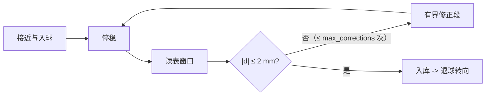

# 双臂运动学标定（K1–K3）实施计划

运动学标定在SHM上的实现规格，供后续分工实施。旧`ros`分支的K1–K5是研发里程碑编号，不是现场工序，不沿用；其平铺脚本与防御性代码不搬回。

## 0. 总体

### 0.1 现场事实

- 拆双手，裸法兰运行；只有一套三表工装，先装左腕测左臂，再换装右腕测右臂。工装无销钉定位，换装后不重新清零。
- 四球台架（DVT2`1105_03`）与机器人刚性连接，名义位姿由CAD配准给出（`trical_assembly.ball_center()`，`references/cad/trical_1105_03/registration.json`）。
- 关节零位为机器人出厂校准，与URDF零位一致（估计每轴0.1–0.3°），K3辨识其修正量；GUI保存的位姿文件只是保存位，与本标定无关。
- 千分表：三只QAS，BLE→nRF52840桥（`firmware/trical_bridge`）→USB CDC JSONL→Orin；`MOD:0`下主动`MEAS`每表约3 Hz；无采样时间戳、无帧号。
- 需求口径（`references/机械臂研发需求(1).pdf`）：验证集位置RMSE内部目标≤0.4 mm、交付≤0.7 mm；单机节拍≤60 min。

### 0.2 三阶段

| 阶段 | 内容 | 产出 |
| :--- | :--- | :--- |
| K1 左臂采集 | 工装在左腕。逐点入球→停稳→读表→（必要时粗修正）→入库→退回；结束失能，**runner退出**。 | `k1/measurements.json`、`k1/report.md` |
| K2 右臂采集 | 换装右腕后`--resume`。流程同K1。 | `k2/measurements.json`、`k2/report.md` |
| K3 联合辨识 | 纯离线，紧随K2执行，也可`--reanalyse`单独重算。 | `k3/report.md`、`delivery/` |

```bash
bash calib/kinematics.sh --robot DVT2_01        # K1：左腕测完失能退出，提示换装
bash calib/kinematics.sh --resume               # 换装右腕后：K2 -> K3 -> delivery
bash calib/kinematics.sh --reanalyse            # 离线重算K3
bash calib/kinematics.sh --plan-only            # 只做路线规划与碰撞检查
bash calib/dev.sh kinematics-mock               # 私有Mock，K1->K2->K3自动贯通
bash calib/dev.sh trical-probe --port /dev/ttyACM0 ...   # 板卡/三表联调
```

`--mode smoke|small|full`（默认`full`）：`smoke`每臂A球1点，用于首次上机；`small`四球各1点，用于快速检查；`full`为正式标定。只有`full`做参数辨识并生成`delivery/`；`smoke`/`small`的K3只输出名义模型残差诊断（`k3/report.md`）。

## 1. 安全逻辑（内部自动执行）

沿用`AGENTS.md`，本阶段相关的具体值：

- 路线：自由空间Coal连续余量≥10 mm；接触段只允许当前工装3个测头与目标球进入`[-5, 0] mm`，登记近接对≥2 mm，其余≥10 mm，接触区姿态偏差≤1°；跨侧球转向前3测头须全部退出至≥+0.5 mm。每个修正段下发前，同时检查该段及从新目标退回接触种子的路径。
- 执行器：起点静止（<0.2 rad/s）、无驱动故障、C++使能前起点重读与限位复核、单owner；SIGINT/TERM/HUP、stdin EOF→失能并等待`0x21`；驱动/通信故障→失能结束会话，不自动恢复。
- 千分表不承担运动中的防撞；所有运动都是有界的静止到静止C3段。
- 接触段修正段要求`|q_to - q_obs| <= max_windup_rad`（防止静摩擦下累加指令后弹射顶表），C++校验，Python按同值限制步长。
- 每臂首个测点入球分两步：在接触种子前2.5 mm停稳读表，确认三槽在量程内且读数随这2.5 mm的变化与预测一致（顺带发现读数卡死的表），再走完剩余行程。两步入球只覆盖轴向偏差，横向捕获范围见2.4节。
- 测试只连`/casbot_calib_test_*`与`MockQasBridge`，不碰`/shm_mc`和真实串口。

## 2. 测量协议

### 2.1 为什么不做精对中

工装是平面测头碰球，模型`readings = A·R_WSᵀ(ball − p_WS) + zero`（`cpp/include/casbot_calib/trical.hpp`）在接触点处于测头平面内、读数在行程内时严格线性。K3直接使用实测偏移`d = A⁻¹(z − zero)`，不要求球心与TCP重合。旧`ros`分支的30 µm对中阈值来自合成Mock配置（提交`cedac82`），没有文献或精度需求依据；对中只降低测头平面度、轴系正交性等二阶误差，相比0.4 mm目标可忽略。因此只要求“入量程”：`|d|∞ <= range_tolerance_m`（默认`2e-3`，见2.4节）。

### 2.2 单点流程



只有一种读表窗口，修正前后用同一套规则：

1. **停稳**：最近`settle_window_s = 0.2 s`内14轴关节包络`max_j(q_max[j] − q_min[j]) <= settle_span_rad`（默认`0.25e-3`）；`settle_timeout_s = 3.0`内未停稳→失能结束。
2. **读表**：停稳后才开始发`MEAS`。每槽一问一答：发出后等到该槽一条测量通知（`kind=1`）再发下一条；参数回执不计。每槽先丢弃`discard_first`条（默认1，覆盖表内缓存滞后，见第5节），再收`samples_per_slot = 3`条。
3. **窗口有效**：每槽极差≤`stable_indicator_span_m = 5e-6`；窗口`[t_start, t_end]`内14轴包络≤`settle_span_rad`；否则重新读一窗。
4. **故障**：单条应答超`reply_timeout_s = 1.5`、无在途请求时收到测量通知、`epoch`变化、断连、`status != VALID`→仪表故障，失能结束会话。数值相同的通知正常计入。
5. **修正**：`|d|∞ > range_tolerance_m`时，按阻尼最小二乘雅可比算笛卡尔修正，单步≤`max_correction_step_m = 1.5e-3`，受`max_windup_rad`限幅，路线检查通过后下发；超过`max_corrections = 3`仍不入量程→失能结束。
6. **入库**：保存窗口起止时间、各槽读数均值；关节均值由analyse按窗口时间从`feedback.bin`计算（唯一来源，`--reanalyse`可重算）。

### 2.3 控制增益与重力前馈

- 增益直接用`configs/robot/dvt2.yaml`的逐轴`kp/kd`（与H1–H3相同：每臂`65/5, 65/5, 30/4, 30/2, 30/2, 20/2, 20/2`），全程不切换，运动学不另设增益。
- 重力前馈使用名义URDF加当前侧工装质量（`tool_mass_kg`、`tool_com_m`），不依赖动力学会话：测量用实测关节角，前馈精度只影响落点。
- `max_windup_rad = 0.012`：肩部约0.78 Nm，腕部约0.24 Nm。腕部在此限内可能突破不了静摩擦，此时修正主要由肩肘完成；2 mm入量程容差下这足够，Mock静摩擦用例验证。

### 2.4 首次入球的捕获范围

测头平面直径9.93 mm（半径约4.96 mm），行程约14 mm。轴向实际受接触段碰撞规则限制（测头进入球`[-5, 0] mm`，表体名义离球5 mm），横向受平面半径限制；留1 mm余量，首次入球可接受单方向偏差约4 mm。

当前零位为机器人出厂校准、与URDF零位一致，按每轴0.1–0.3°估计。名义模型下首次入球偏差主要来自零位误差和台架CAD误差。按8个接触种子、各轴零位误差独立均匀分布的一阶雅可比估算，工装坐标系下单方向偏差：

| 每轴零位误差 | p95 | 线性最坏 |
| :--- | :--- | :--- |
| 0.1° | 1.1 mm | 2.2 mm |
| 0.3° | 3.4 mm | 6.5 mm |
| 0.5° | 5.7 mm | 10.8 mm |

出厂零位精度下捕获范围基本够用，不加零位粗校。极端组合由每臂首点两步入球兜底：停在接触种子前2.5 mm时三槽须均已接触，且外推到接触种子的偏移在上述范围内，否则失能结束，由操作员按文档处理。

`range_tolerance_m`取`2e-3`（平面半径的约40%）：出厂零位下多数测点无需修正，单点耗时最少。Mock与路线检查中的测头平面半径改用`4.96e-3`。

## 3. 辨识（K3）

### 3.1 参数

| 组 | 维数 | 说明 |
| :--- | :--- | :--- |
| 关节零偏 | 14 | 双臂全部关节。工装无销钉，腕roll零偏中包含工装绕法兰的装夹角；若后续腕roll偏差明显，再处理装夹基准。 |
| 台架位姿修正 | 5 | 相对CAD配准的平移3＋绕x、z转动。绕y转动固定为CAD值：两肩pitch轴共线，台架绕y转动与两肩pitch公共零偏不可分，由刚性台架的CAD给出基准。 |
| 连杆几何 | 候选 | 每臂基座6维＋后6轴MDH/Hayati各4维；在上述19维的正交补空间做列主元QR，只放行缩放条件数≤200的列，其余保持名义。 |

工装装夹偏差暂不建模。前两组共19维，满秩由参数化保证；以基于`release_turn_reference`接触种子、肘部自运动加1°姿态扰动的设计核算，秩19、缩放条件数约68。WP3单测断言Mock设计下的秩，运行时不另加秩检查。

### 3.2 求解与输出

- 仅`full`执行本节；`smoke`/`small`的K3只报告各测点名义残差（球心偏移、按臂按球汇总），不拟合、不生成`delivery/`。
- 第1层：19维有界线性/TRF；第2层：在其基础上加入选中的几何列，`least_squares(method='trf', loss='soft_l1')`，Pinocchio C++回归量（`_core.point_geometry_batch`）。
- 留出：训练/留出姿态按最小关节距离隔离。报告名义、第1层、第2层的留出球心RMSE；第2层使任一臂留出RMSE劣于第1层时，交付第1层结果。
- 交付`delivery/`：
  - `joint_offsets.yaml`：14轴关节零偏修正（SHM ID、弧度、`q_true = q_encoder + offset`）。
  - `calibrated.urdf`：只写入几何修正，关节零偏不折入；保留源URDF全部惯性参数；Pinocchio重加载FK复核。
  - `summary.md`：测点数、读表极差、台架位姿修正、三层留出RMSE、零偏表。
  - `calibration_bundle.json`：选中参数、台架估计、各阶段来源。

## 4. 目录与清理

```text
calib/kinematics.sh                    # 唯一运动学入口
calib/dev.sh                           # + trical-probe、kinematics-mock
configs/kinematics/k.yaml              # 工装质量、三表地址映射、窗口与修正参数、K3条件数（增益沿用robot/dvt2.yaml）
configs/shm/k_mock.json                # 裸法兰SHM Mock + 3Hz QAS
cpp/src/shm/field_runtime.cpp          # + --bare-flange
cpp/src/shm/trical_runtime.{hpp,cpp}   # 分段保持执行器
cpp/tools/shm_trical_executor.cpp
python/casbot_calib/trical/
  assembly.py                          # 迁入trical_assembly.py
  indicators.py                        # IndicatorEvent、UsbBridgeIndicatorDriver、MockQasBridge
  window.py                            # 停稳+读表窗口
  routes.py                            # 路线检查、首点两步入球、D-optimal选点
  controller.py                        # 执行器客户端+单点流程
  solver.py                            # 参数图、两层求解、URDF/零偏导出
python/casbot_calib/stages/kinematics/{common,k1_left,k2_right,k3_identify}.py
docs/kinematics.md
```

清理：删除`configs/kinematics_trical.yaml`、`configs/staged_dual_arm.yaml`、`configs/static_field_nominal.yaml`、`configs/dvt2_model_candidate.yaml`及`configs/dvt2/`中不再使用的文件、`python/casbot_calib/assets/trical_capture_defaults.json`；清除`kinematics.py`、`model_context.py`中的`synthetic_only`/`hardware_executable`拦截。

GUI保存位文件由`fieldwork/zero.yaml`改名为`fieldwork/gui_pose.yaml`（Orin上一次性`mv`，不做兼容读取），避免与`joint_offsets.yaml`混淆。

## 5. 工作包

### WP1：C++执行器与裸法兰

- `--bare-flange`：构造`hand_count = 0`的`CommandFrame`；`takeover.ensure_ready_channel(require_hand_background=False)`跳过手部快照。
- `shm_trical_executor --shm <ep> --urdf <f> --output <dir> --bare-flange --tool-side left|right --tool-mass-kg M --tool-com-m x,y,z --max-windup-rad 0.012`（kp/kd与H系列一样从`configs/robot/dvt2.yaml`传入）
- 启动检查后在实测起点保持，输出`{"type":"ready","mono_ns":..,"q0":[14]}`。
- stdin指令：
  - `{"id":N,"type":"segment","duration_ns":..,"q_from":[14],"q_to":[14],"windup":true|false}`：要求空闲保持、`q_from`等于当前保持点、`q_to`在限位内、C3峰速≤`min(1.5, v_urdf)`、`windup=true`时`|q_to − q_obs| <= max_windup_rad`。失败回`{"type":"reply","id":N,"ok":false,"reason":..}`并继续保持；通过则执行，结束后保持`q_to`并发`segment_done`。
  - `{"id":N,"type":"finish"}`：失能、等`0x21`、写`feedback.bin`/`commands.bin`/`events.csv`/`result.txt`，退出码0。
- 每20 ms一行`state`：`mono_ns`、`holding`、`active_id`，以及自上一行以来20帧的`q_mean[14]`、`q_min[14]`、`q_max[14]`（不重叠块，Python可拼出任意块对齐窗口的精确均值与包络）。
- 不设跟踪误差故障（与H系列执行器一致）。
- 验证：`ctest -R shm_trical`覆盖多段衔接、5 s静默保持`max_send_gap_ns < 5 ms`、windup拒绝、stdin EOF失能。

### WP2：千分表驱动、Mock与读表窗口

- `UsbBridgeIndicatorDriver`：复用`firmware/tools/trical_usb.py`行解析；按配置的 `{axis: {address, address_type, sign}}` 匹配当前就绪槽位；确认`subscribed/state=ready`、`MOD:0`；每槽一问一答；原始JSONL落盘`<stage>/capture/indicators_raw.jsonl`。
- `MockQasBridge`：表内值按自身节拍（默认约3 Hz）由隐藏零偏/几何扰动后的真实接触计算并缓存，`MEAS`返回当时缓存值，应答延迟可配；可注入丢包、停更、断连、读数卡死。关节接入静摩擦模型（`|τ| < τ_s`时不动）。
- `SettledWindowCollector`：实现2.2节1–4。
- 验证：缓存跨越停稳时刻的旧值被`discard_first`剔除；相同读数正常入窗；停更/断连/无请求通知按故障结束；窗口内关节漂移超包络时重读。

### WP3：路线、单点控制与辨识

- `assembly.py`、`routes.py`：加载`assets/trical_1105_release_turn_reference.json`的8条进退种子路线；第1节路线检查；在接触种子邻域按D-optimal生成姿态（`smoke`每臂A球1点；`small`四球各1点；`full`每球训练3–4点＋留出1–2点）。
- `controller.py`：执行器子进程＋窗口采集器，实现2.2节流程与首点两步入球；结束`finish`后从`feedback.bin`算窗口关节均值，写`measurements.json`。
- `solver.py`：第3节。
- 验证：合成数据含隐藏14轴零偏、台架2 mm/0.2°偏移（绕y除外）、连杆几何误差：19维参数恢复到噪声水平，留出RMSE<10 µm；Mock静摩擦下修正被windup限幅且最终入量程；重加载URDF的FK与质量矩阵误差<1e-12。

### WP4：Pipeline与阶段

- `Stage`增加`family`（`dynamics`/`kinematics`）、`execution_kind`（`reference`/`interactive`/`offline`）、`requires_hand_background`、`stop_after`。K1设`stop_after = True`：runner完成K1后正常退出并提示换装后`--resume`；Mock入口忽略`stop_after`。同一命令不混跑`h*`与`k*`。
- `session.json`记录`family`；`--resume`/`--reanalyse`未给目录时取最近一个同`family`会话。
- `offline`阶段（K3）跳过二进制、硬件与接管检查。
- delivery生成第3.2节文件。
- 验证：私有端点＋Mock下`small`跑通`K1 → 退出 → --resume → K2 → K3`且只出名义残差诊断；`full`（Mock表频调高以缩短用时）跑通到`delivery/`；`--plan-only`、`--reanalyse`；H1–H3回归全绿。

### WP5：入口、配置与文档

- `calib/kinematics.sh`沿用`dynamics.sh`写法；`dev.sh`增加`trical-probe`、`kinematics-mock`。
- `configs/kinematics/k.yaml`、`configs/shm/k_mock.json`；第4节清理与GUI文件改名。
- `docs/kinematics.md`：现场确认（台架、拆手装工装、标准球清零、急停在手）→怎么跑（K1、换装、`--resume`、重算）→配置（串口与地址映射）→结果怎么看（`delivery/summary.md`）。更新`README.md`、`AGENTS.md`中运动学状态。

### 顺序

WP1、WP2、WP3（assembly/routes/solver）并行 → WP3 controller → WP4 → WP5与全仓验证：

```bash
bash scripts/humble/container.sh bash scripts/humble/validate.sh < /dev/null
bash scripts/shm/build.sh --with-mock
bash scripts/humble/container.sh bash calib/kinematics.sh --plan-only < /dev/null
bash scripts/humble/container.sh bash calib/dev.sh kinematics-mock --mode small < /dev/null
bash scripts/humble/container.sh bash calib/kinematics.sh --reanalyse < /dev/null
```

## 6. 板卡到货后的实测

用`calib/dev.sh trical-probe`完成，结果填入`configs/kinematics/k.yaml`：

1. 三表并发一问一答的应答间隔p50/p95→确认`reply_timeout_s`与节拍。
2. 机械臂在球上走已知0.2 mm微步并停稳，看停稳后第几条应答开始反映新位置→确定`discard_first`。
3. 逐一轻按测头，核定仪表地址→工装x/y/z轴向、正负号与标准球清零读数。
