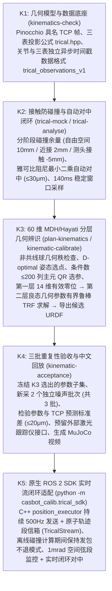

# 📐 双臂千分计运动学标定方案详解（TriCal 原理与 K1–K5 全流程）

本文档用直观的工程语言梳理 `casbot_calib` 仓库中**双臂接触式运动学标定（TriCal，K1–K5）**的硬件测量原理、分阶段防碰撞与自动对中状态机、60 维 MDH/Hayati 分层辨识算法、三批重复性验收，以及 **K5 原生 ROS 2 SDK 实时闭环控制架构**与常用命令。

> 📌 **当前进度与实机边界说明**：
> * **K1–K4（算法、工装与离线全流程闭环）**：已完成 DVT2 `1105_03` 真实四球工装 CAD 装配、连续防碰撞进退路线、三表物理模拟器（`TricalMockSession`）、雅可比闭环自动对中、60 维 MDH/Hayati 参数辨识、候选 URDF 导出及三批重复性验收。
> * **K5 第一轮（原生 ROS 2 SDK 实时控制与闭环对中，已接入）**：已通过 [trical_sdk.py](../python/casbot_calib/trical_sdk.py) 与 C++ [trical_stream.hpp](../ros/casbot_calib_vendor/include/trical_stream.hpp) 将 TriCal 对中状态机接入 `position_executor` 原生 500Hz 持续指令流（详见第 六 节与 [K5 实时适配说明](kinematics_k5_sdk_realtime.md)）。
> * **安全门禁边界**：当前 K5 默认绑定本地私有 `sdk_mock_server`（由 SDK 实时反馈关节角驱动模拟三表读数），Python 与 C++ 双层拦截公共实机端点；待后续接入真实千分计硬件驱动并核验实测球架/测杆行程后，再放开实机碰球。

---

## 🧭 一、硬件测量原理：三轴千分计怎么标定运动学？（K1 基础）

传统的激光跟踪仪标定成本高昂，而 **TriCal（三正交千分计接触式自标定）** 利用机械臂末端安装的低成本高精度千分计工装与固定在台面上的基准球架，构成闭环几何位置约束。

### 1. 实际工装与四球台架装配（DVT2 `1105_03` 方案）
* **单工装左右换装**：拆掉双臂普通手部，只使用**一个三轴千分计工装（TriCal Tool）**。先将其安装在左腕法兰上（相对 STEP 旋转 $+90^\circ$）测完左臂全部测点；双臂回到安全位停稳后，人工拆下换装到右腕法兰（$0^\circ$）测右臂。不参与测量的一侧手臂始终以裸法兰状态停放在安全位。
* **四球基准台架**：在机器人前方固定一个带有 **4 个高精度基准钢球（A / B / C / D）** 的球架平台。
* **三正交平面测头**：千分计工装上装有 3 只具有明确单位法向（记为行向量构成的矩阵 $A \in \mathbb{R}^{3\times 3}$）的**平面测头千分计**。当机械臂带着工装套向某个基准球时，3 个平面测头从三个正交方向同时顶住球面。

### 2. 三表读数到球心坐标的几何投影公式
源码实现见 [trical.hpp](../cpp/include/casbot_calib/trical.hpp)。经过事先对标准球半径的机械清零（Mastering，记对中零点读数为 $z_{\text{center}} \in \mathbb{R}^3$）后：

1. **正向投影（由球心位置算表读数）**：
   三只千分计的读数 $z \in \mathbb{R}^3$ 直接等于**基准球球心 $p_{\text{ball}}^W$ 相对于工装传感器原点 $p_{\text{sensor}}^W$ 在传感器局部坐标系下的位移投影**：
   $$z = A \cdot R_{WS}^T(q, x) \left(p_{\text{ball}}^W - p_{\text{sensor}}^W(q, x)\right) + z_{\text{center}}$$
   其中 $(p_{\text{sensor}}^W, R_{WS})$ 是由当前关节角 $q$ 和待标定几何参数 $x$ 通过 Pinocchio 正运动学（FK）算出的工装位姿。

2. **逆向解算（由实测表读数算球心偏移）**：
   只要读出三只表的稳定读数均值 $\bar{z}$，就能直接还原出球心相对于工装 TCP 原点的三维实测偏移向量：
   $$d_{\text{sensor}} = A^{-1}(\bar{z} - z_{\text{center}})$$

3. **运动学标定的三维位置残差方程**：
   由此得到每个测点 $k$ 的三维空间位置残差 $r_k(q_k, x) \in \mathbb{R}^3$（见 [kinematic_identification.py:117-118](../python/casbot_calib/kinematic_identification.py#L117-L118)）：
   $$r_k(q_k, x) = \underbrace{p_{\text{sensor}}^W(q_k, x) + R_{WS}(q_k, x) \, d_{\text{sensor}, k}}_{\text{由实测关节角 } q_k \text{、几何参数 } x \text{ 和千分计读数推算的球心位置}} - \underbrace{p_{\text{ball}, k}^W}_{\text{基准球真实世界坐标}}$$

> 💡 **为什么不需要把表读数死磕到绝对 0？**
> 只要千分计测头接触良好且在有效量程内（代码中自动对中要求偏差 $\le 30\,\mu\text{m}$），残余的几十微米读数已经通过 $d_{\text{sensor}}$ 精确补偿进了残差方程里，因此无需反复微调去追求读数绝对归零。

---

## 🗺️ 二、K1 → K5 阶段架构总览



---

## 🛡️ 三、K2：带着千分计怎么安全碰球？（防碰撞 + 自动对中状态机）

运动学标定在动作控制上最大的挑战是：**必须把末端工装伸进紧凑的球架内部让测头顶住钢球，但绝不能让表架、手腕或另一条手臂刮碰到球杆或平台**。相关实现位于 [trical_fixture.py](../python/casbot_calib/trical_fixture.py)、[trical_workflow.py](../python/casbot_calib/trical_workflow.py) 和 [dvt2_trical.py](../python/casbot_calib/dvt2_trical.py)。

### 1. 分阶段动态碰撞门禁（Coal 连续轨迹证明）
在进出球架的不同阶段，碰撞检查器会动态切换距离阈值：
* **自由空间转移段（Free Space）**：双臂、躯干、腰部夹具、工装与全部球/球杆之间，全部活动碰撞对必须保持 **$\ge 10\text{ mm}$** 的连续安全余量。
* **局部接近 / 插入 / 对中 / 退出段（Contact Route）**：
  * **特许接触对**：**仅允许当前工装的 3 个具名测头薄片（Probe Tips）与当前目标球**发生有界接触，表面距离允许下探至 **$-5\text{ mm}$**（对应测杆压缩行程）。
  * **近接结构对**：已登记的工装外壳与邻近球杆保持 **$\ge 2\text{ mm}$** 余量；其余所有部位（手腕、另一臂、非目标球）依然严格要求 **$\ge 10\text{ mm}$** 余量。
  * **接触区 $1^\circ$ 姿态锁定与先退后转**：在接触段内，工装相对参考朝向的旋转偏差被限制在 **$1^\circ$** 以内（防止测头在球面上大角度偏转别断表杆）。对于左臂测 D 球、右臂测 C 球等跨侧路线，必须在 3 个测头全部退离球面至少 **$0.5\text{ mm}$ 正间隙**后，才允许进入手腕转向段！

### 2. 雅可比自动对中状态机（`MeasurementController`）
由于标定前机器人存在几何误差与编码器零偏，按名义逆运动学（IK）走过去时，球心往往偏离千分计中心数百微米。控制器按以下状态机自动完成闭环对中：

```text
选择工具与目标球 → 预检完整进退路径 → 自由空间接近 → 沿局部路线插入
→ 等待稳定 → 读取三表通道 → 雅可比阻尼最小二乘计算 Δq → 预检新位置退出路径
→ 下发微调并保持 → 满足偏差 ≤ 30μm 且通过 140ms 稳定窗口 → 保存测量 → 按原路退出回位
```

* **如何计算微调步长 $\Delta q$？**：
  读取三表算出球心偏移 $d_{\text{sensor}}$ 后，在**当前实测关节角 $q_{\text{obs}}$** 处调用 Pinocchio 计算 TCP 雅可比 $J_v(q_{\text{obs}})$，用阻尼最小二乘求出修正量 $\Delta q$（单次限制最大笛卡尔步长 $\le 1.5\text{ mm}$、单轴步长 $\le 0.02\text{ rad}$）。
* **工程防坑细节（修正累加在指令目标上）**：
  微调指令**必须累加在上一轮的指令目标 $q_{\text{cmd}}$ 上**（$q_{\text{cmd}} \leftarrow q_{\text{cmd}} + \Delta q$），而不能用 $q_{\text{obs}} + \Delta q$ 覆盖——因为关节 PD 存在静态跟踪误差，若每次以 $q_{\text{obs}}$ 为基准，每轮都会把伺服静差重新引进来，导致永远收敛不到 $30\,\mu\text{m}$ 以内。
* **140ms 稳定采样窗口（`stable_window`）**：
  当三表推算的偏移进入 $\le 30\,\mu\text{m}$ 后，要求连续 **140ms** 内至少收到 6 组三通道序号严格递增、状态全部为 `VALID` 的新数据包，且关节速度、角度波动与表读数波动均低于阈值，才将该窗口内的实测关节角均值 $\bar{q}$ 与表读数均值 $\bar{z}$ 记入有效数据集。

---

## 🧮 四、K3：60 维 MDH/Hayati 参数化与两层鲁棒辨识

收集到多个球、不同构型下的有效测点后，K3（[kinematic_parameters.py](../python/casbot_calib/kinematic_parameters.py)、[kinematic_identification.py](../python/casbot_calib/kinematic_identification.py)）负责求解几何误差并导出修正后的 URDF。

### 1. 为什么必须至少 3 个非共线基准球？
如果每条手臂只测 2 个球，整条机械臂绕着“两球球心连线”发生微小刚体旋转时，两个球心的位置约束完全不变（存在不可观测的旋转规范自由度）。因此求解器在启动时会先计算每条手臂所测球心的几何秩（`anchor_geometry`），强制要求**至少 3 个非共线目标点**（DVT2 实际工装采用 A/B/C/D 四球，K3 合成工装采用六球）。

### 2. 60 维 Craig MDH + Hayati 参数图
直接对 URDF 中 14 个关节各自的 6 维刚体变换（84 个参数）求导会产生严重的共线冗余。代码将其映射为标准的 **TriCal 论文五因子变换链**：
$$T_i = R_x(\alpha_i) \, T_x(a_i) \, R_y(\beta_i) \, R_z(\theta_i + q_i) \, T_z(d_i)$$
* **常规相邻关节（MDH）**：包含扭角 $\alpha_i$、杆长 $a_i$、关节零偏 $\theta_i$、轴向偏置 $d_i$ 共 4 个参数（固定 $\beta_i = 0$）。
* **近平行相邻关节（Hayati 扩展）**：当两轴接近平行时，公法线位置对微小角度极其敏感，此时自动启用 $\beta_i$ 参数避免奇异。
* **每臂 30 维（双臂共 60 维）候选参数构成**：
  * 首轴基座安装变换 **6 个参数**（`tx, ty, tz, rx, ry, rz`，其中 `rz` 代表第 1 轴的有效零位偏移）。
  * 第 2～7 轴每轴 **4 个 MDH 参数**（$6 \times 4 = 24$ 个）。
* **无量纲尺度归一化**：所有角度参数按 **$1\text{ mrad}$** 归一化，所有长度参数按 **$0.2\text{ mm}$** 归一化；无量纲优化变量限制在 $[-3, +3]$ 区间内（对应最大 $\pm 3\text{ mrad}$ 和 $\pm 0.6\text{ mm}$）。
* **底层雅可比加速**：所有几何参数对末端位置的偏导数均通过 C++ Pinocchio 的 `computeJointKinematicRegressor` 批量计算（释放 GIL），并把非零千分计偏移 $d_{\text{sensor}}$ 的旋转杠杆效应精确包含在内。

### 3. 列主元 QR 选参与两层有界鲁棒求解（`solve()`）
即便采用 60 维 MDH 参数，受限于球架空间位置和关节限位，60 列雅可比矩阵的完整条件数仍可能高达上千。直接全参数拟合会导致弱可观测方向剧烈振荡。为此，`kinematic_identification.py` 采用了**“先零位、再选列、两步 TRF 鲁棒优化”**策略：

1. **第一层：锁定 14 维有效零位层（`zero_stage`）**
   * 首先提取双臂 14 个关节的有效零位列（每臂首轴安装 `rz` + 后 6 轴 `theta`）。检查训练数据在这 14 列上是否满秩且缩放条件数 **$\le 200$**。
2. **第二层：正交投影 + 列主元 QR 扩充几何参数（`select_parameters`）**
   * 将剩余 46 个几何参数列投影到 14 维零位层的正交补空间上，使用**带列主元的 QR 分解（Column-Pivoted QR）** 按独立信息量从大到小排序。
   * 逐列尝试加入候选集，**只接纳加入后仍能保持满秩且整体条件数 $\le 200$ 的参数列**；其余弱可观测参数固定为 0（保留 CAD 名义先验）。
   * *例如在 DVT2 四球实验中，60 个候选参数自动选出了 **31 个良态参数**（条件数 $190.37 \le 200$）。*
3. **两阶段信赖域反射法（TRF + `soft_l1` 鲁棒损失）**
   * 先用有界线性最小二乘（`lsq_linear`）求出 14 个零位的初值，再用非线性 `least_squares(method='trf', loss='soft_l1')` **单独拟合 14 维零位层**；
   * 随后以零位解为起点，**放开选出的全部良态几何列联合精修**。
   * *在 DVT2 独立验证集上，位置约束 RMSE 从名义模型的 **$40.25\,\mu\text{m}$** 降至零位层的 **$12.25\,\mu\text{m}$**，最终几何层精修后降至 **$0.879\,\mu\text{m}$**。*
4. **导出候选 URDF（保持质心与惯量世界系等价）**
   * `kinematic_export.py` 将辨识出的几何修正写回 URDF 关节的 `origin`，同时对各连杆的局部质心和惯量张量做刚体坐标反变换，确保导出后的 `candidate.urdf` 在零偏修正下具有完全等价的物理质量分布。

---

## 📊 五、K4：三批重复性验收与外部计量接口

详见 [kinematics_trical_k4.md](kinematics_trical_k4.md)。为了验证标定出的几何参数不是单次噪声下的偶然结果，K4 执行严格的**跨批次重复性检验**：

1. **冻结参数子集，重采两批独立数据**：
   * 锁死 K3 训练集选出的那组参数列（不允许换列），额外启动两个不同随机噪声种子的模拟器会话，把全部训练测点重新跑两遍完整的“接近 $\rightarrow$ 自动对中 $\rightarrow$ 稳定采样 $\rightarrow$ 退出”。
2. **双重离散度门槛**：
   * 比较三个独立训练批次算出的几何参数：要求无量纲参数的样本标准差最大值 **$\le 0.15$**。
   * 比较三个模型在公共独立验证集上的末端 TCP 位置预测：要求预测位置样本标准差最大值 **$\le 20\,\mu\text{m}$**（DVT2 实测最大标准差为 **$0.856\,\mu\text{m}$**）。
3. **外部独立位置计量接口（`kinematic_metrology.py`）**：
   * 由于共用同一个球架无法检出球架自身的制造/安装系统误差，K4 定义了标准的 `kinematic_external_position_v1` 数据契约，用于未来接入激光跟踪仪或三坐标测量机（CMM）的独立静态测点，完成最终的 $0.4\text{ mm}$ 绝对位置精度验收。

---

## ⚡ 六、K5：原生 ROS 2 SDK 实时流闭环适配（`trical_sdk`）

在 K2–K4 中，Python 控制器运行在虚拟时间（Virtual Time）下：Python 算完一步 Coal 碰撞证明和雅可比修正，再推进 C++ 仿真器。但在真实的 ROS 2 SDK 环境中，**一旦切入 `/motion/upper_body_debug` 调试模式，客户端必须以 500Hz（每 2ms 一帧）不间断地向机器人发送指令**——如果因为 Python 在后台算 Coal 连续碰撞或等待千分计稳定而停发哪怕 100ms，机器人看门狗就会直接断流退模式！

为此，**K5 第一轮**（[trical_sdk.py](../python/casbot_calib/trical_sdk.py)、[trical_stream.hpp](../ros/casbot_calib_vendor/include/trical_stream.hpp)、[docs/kinematics_k5_sdk_realtime.md](file:///home/ww/codings/casbot_calib/docs/kinematics_k5_sdk_realtime.md)）专门构建了 **“Python 异步规划对中 + C++ `position_executor` 500Hz 持续发包保持”** 的双层实时协同架构：

```mermaid
sequenceDiagram
    participant Py as Python (RealtimeController / trical_sdk.py)
    participant Box as 原子信箱 (segment.csv)
    participant Exec as C++ (position_executor + TricalStream)
    participant SDK as CASBOT ROS 2 SDK / Mock

    Py->>SDK: 1. 只读快照读取实测起姿 q_start，检查并规划到路线 home 的连接
    Py->>Box: 2. 写入 generation=1 (action=0: 保持实测起姿 q_start)
    Py->>Exec: 3. 启动常驻 position_executor，切入 /motion/upper_body_debug
    loop 全程 500Hz 不间断发送 (含名义重力前馈 + K2 逐轴 PD)
        Exec->>SDK: 发布 /upper_body_debug/joint_cmd (500Hz)
        SDK-->>Exec: 1000Hz /joint_states 反馈 (检查 1mrad 空间弦段误差)
        Exec-->>Py: 管道推送 TRICAL_FEEDBACK (驱动模拟三表读数)
    end
    Py->>Py: 4. 后台执行 Coal 连续碰撞预检 (期间 C++ 继续 500Hz 保持当前目标)
    Py->>Box: 5. 原子写入新轨迹段 generation=k (action=1, q_from, q_to, duration)
    Exec-->>Py: 6. 返回 TRICAL_ACK，C++ 内部按七次 Hermite (C3) 插值走完并自动转入末点保持
    Py->>Py: 7. 读三表 → 雅可比计算 Δq → 证明退路 → 提交微调段 → 140ms 稳定窗口采样
    Py->>Box: 8. 测点完成，写入 action=2 (正常结束)，C++ 请求退出调试模式
```

### K5 的 5 个关键工程设计：

1. **单次模式会话与原子轨迹段信箱（`TricalStream`）**：
   * 从进入测点到退出回位，**同一个 C++ `position_executor` 进程全程保持在 `UPPER_BODY_DEBUG` 模式，绝不中途退模式或断流**。
   * Python 每次完成某一段（接近、插入、微调或退出）的 Coal 碰撞证明后，将 31 个浮点数 `[generation, action, duration_s, q_from(14), q_to(14)]` 原子替换写入 `segment.csv`。
   * C++ 端的 `TricalStream`（[trical_stream.hpp:45-53](file:///home/ww/codings/casbot_calib/ros/casbot_calib_vendor/include/trical_stream.hpp#L45-L53)）收到新 `generation` 后，立即在 C++ 内部以 **500Hz** 精确计算七次 Hermite 多项式（$s(u) = 35u^4 - 84u^5 + 70u^6 - 20u^7$，与 Python 离线证明的曲线达到 $1.11 \times 10^{-14}$ 机器精度一致），走完后无缝锁定在终点 `q_to` 继续发包保持，等待 Python 下一条指令。
2. **用“空间弦段距离（`1 mrad`）”替代时间戳跟踪检查**：
   * 因为实机 SDK 的 `header.stamp` 是发布时刻而非采样时刻，且存在缓存重复帧，K5 **不把接收/发布时间当成采样时间去做时间轴对齐**，而是由 `TricalStream::chord_distance`（[trical_stream.hpp:16-23](file:///home/ww/codings/casbot_calib/ros/casbot_calib_vendor/include/trical_stream.hpp#L16-L23)）实时计算每帧实测关节角 $q_{\text{obs}}$ 到当前轨迹段起止点连线（14 维空间弦段）的最大切比雪夫正交偏差，要求严格 **$\le 1\text{ mrad}$**。
3. **显式名义重力前馈與速度余量**：
   * 在 K5 运动期间，C++ 执行器实时计算并叠加当前名义模型的重力前馈（不加摩擦或惯量前馈），PD 使用 K2 逐轴配置。
   * 为给 `0.35 rad/s` 的实测反馈速度保护上限留足安全余量，K5 将进退路线的规划参考最大速度设为 **`0.25 rad/s`**（加速度 `0.5 rad/s²`、Jerk `4.0 rad/s³`）。
4. **基于实时 SDK 反馈的模拟三表（`SimulatedIndicators`）**：
   * 在接入真实千分计硬件前，`trical_sdk.py` 中的 `SimulatedIndicators` 直接订阅 `position_executor` 从 ROS 2 SDK 收到的实测关节位置 $q_{\text{obs}}$，叠加预设的 $(+120, -80, +60)\,\mu\text{m}$ 初始偏置生成三表读数，驱动控制器真正走完一次雅可比微调闭环（本机左臂 A 球实测微调后残余偏移仅 **$0.258\,\mu\text{m}$**，全程 23,514 帧最大发送间隔 `7.04ms`，远低于 `100ms` 看门狗）。
5. **故障即停，绝不盲目自动退刀或 Resume**：
   * 一旦发生操作取消、千分计断线/超量程、关节或模式超时，立即终止当前会话并停止发包，**不会在故障状态下盲目执行自动退刀或重新申请控制模式**。

---

## 🚀 七、常用运动学命令速查表

以下命令均在仓库根目录下通过 Humble 容器入口执行（注意每次输出的目录不能提前存在）：

```bash
# 1. K1 基础检查：验证 Pinocchio 具名 TCP、6×14 雅可比有限差分与三表投影公式
bash scripts/humble/container.sh casbot-calib kinematics-check \
  --config configs/kinematics_trical.yaml --output artifacts/my_k1_check

# 2. K2 单点/全点对中闭环演练（C++ 虚拟时间模拟器，使用 DVT2 1105_03 实际四球装配）
bash scripts/humble/container.sh casbot-calib trical-mock \
  --config configs/dvt2/kinematics.yaml --first-only --output artifacts/my_dvt2_k2
bash scripts/humble/container.sh casbot-calib trical-analyse \
  artifacts/my_dvt2_k2 --output artifacts/my_dvt2_k2_analysis

# 3. K3 姿态选点规划 + 接触对中采集 + 60 维 MDH/Hayati 分层辨识 + 导出 candidate.urdf
bash scripts/humble/container.sh casbot-calib plan-kinematics \
  --config configs/dvt2/kinematics.yaml --output artifacts/my_dvt2_kin_plan
bash scripts/humble/container.sh casbot-calib kinematic-calibrate \
  --plan artifacts/my_dvt2_kin_plan --output artifacts/my_dvt2_kin_calibration

# 4. K4 三批独立重复性验收 + 生成中文 3D 运动回放视频 (kinematic_workflow.mp4)
bash scripts/humble/container.sh casbot-calib kinematic-acceptance \
  --reference artifacts/my_dvt2_kin_calibration --output artifacts/my_dvt2_kin_acceptance --fps 12

# 5. K5 原生 ROS 2 SDK 实时流闭环单点演练（启动私有 SDK Mock，跑通左臂 A 球接近/修正/采样/退出）
bash scripts/humble/container.sh bash scripts/humble/vendor.sh \
  python -m casbot_calib.trical_sdk --mock --domain-id 86 \
  --case left_A --output artifacts/my_k5_point
```

> 🔗 **运动学与动力学的版本衔接提醒**：
> 当未来实机运动学标定完成并启用新的 `candidate.urdf` 后，由于关节零位和连杆长度发生了改变，**必须使用新 URDF 重新生成碰撞凸包缓存，并在新几何模型下重新校验或重跑动力学标定（H2–H4）**，不可直接混用旧几何下的动力学参数。
