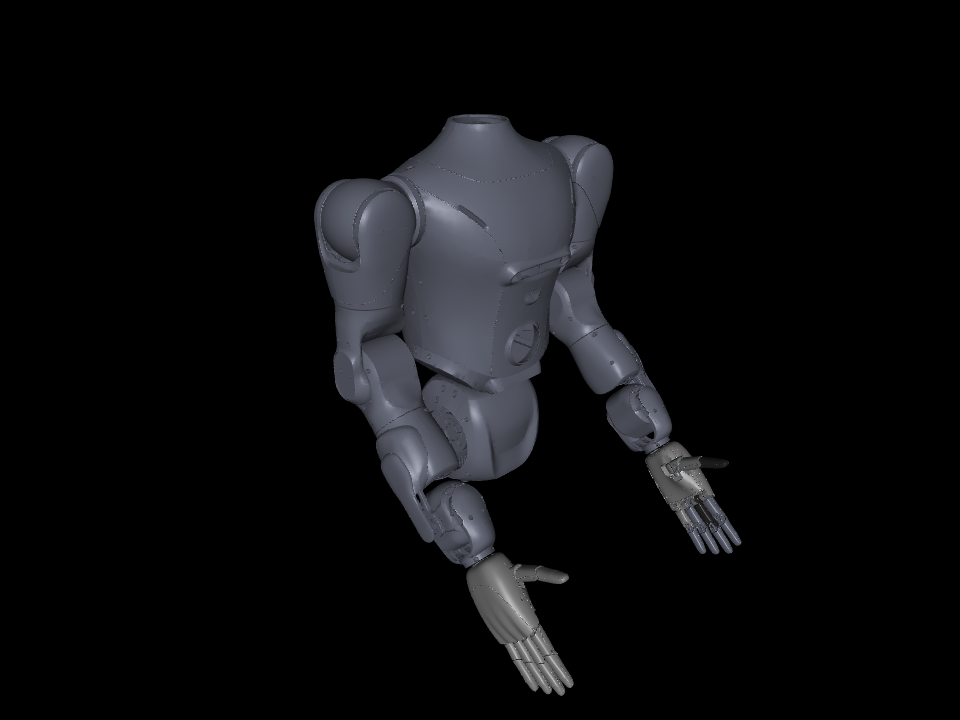

# 只读 viewer 与标定流程演示

## 边界

MuJoCo 只承担场景编译、几何坐标更新和显示，运行路径只调用 `mj_kinematics`、`mj_camlight` 及可视化 API。**不调用 `mj_forward`、`mj_inverse`、`mj_step` 或机械动力学回调。** MJCF 中的质量等编译字段不用于标定，不从 viewer 读取力矩、加速度或接触力。

Mock 继续使用原有 C++ 模型；未来实机直接提供采集状态。两者经过同一个遥测转换器和 `StateFrame` 进入 `JointView`。接实机时只换数据来源，不增加或删除任何 MuJoCo 机械计算。当前没有 SOEM、SDK 连接、使能或电机控制入口。

采用自有 GLFW 显示循环，不使用可能附带仿真推进的托管 viewer。渲染与采集没有同步控制依赖；`LatestStateSource` 只保存最新不可变状态，渲染来不及时丢中间显示帧，不反压采集。接收停滞时冻结最后姿态并显示 `STALE`，不猜测电机后续运动。

## 已生成结果

本机最新版输出：[artifacts/calibration_zh_release](../artifacts/calibration_zh_release/README.md)。旧演示数据保留。

- `presentation/calibration_workflow.mp4`：H.264、1280×720、24 fps、984 帧、41 秒，约 2.5 MB。
- `presentation/01_direction.png` 至 `08_summary.png`：八个阶段截图。
- `demo_report.json`、`identified_model.json`：数值结果和候选模型。
- `control_metrics.csv`、`pd_candidates.csv`、`identified_parameters.csv`：四组控制结果、50 组 PD 候选和参数。
- `workflow_events.jsonl`：开始、检查通过／失败、完成事件；失败会停止流程并保留原始记录。
- `records/`：每次独立采集的观测、命令、单位、原始遥测和分离的评估真值。
- `workflow_config.json`：采集开始前固化的驱动、先验、噪声和验收阈值。
- `gravity_model.json`：独立工况下的重力模型及省略重力对照。
- `records/*/session.json`：逐批驱动配置摘要、控制周期和显式工况。
- `mapping.json`、`telemetry_example.jsonl`：可直接给只读 viewer 使用的接口示例。
- `evidence_sha256.json`、`presentation/viewer_manifest.json`：渲染前后原始证据哈希检查及编码信息。

视频展示真实实验结果的回放，不伪装成参数在线收敛。每个阶段是独立采集批次，切换时可以重置状态；画面标记了回放速度。控制对照显示 1 s 启动段之后的独立验证区间，和报告的 RMSE 定义一致。参考／对照杆仅在显示高度上错开，角度不放大。

## 环境与运行

本机使用 `/opt/miniforge` 下的 conda，环境名 `casbot_calib`：

```bash
source /opt/miniforge/etc/profile.d/conda.sh
conda activate casbot_calib
cd ~/codings/casbot_calib
casbot-calib demo --config configs/workflow_demo.yaml --output artifacts/new_demo
```

输出目录必须不存在，避免覆盖原始采集。无 GUI 运行时，Linux 自动选择 EGL；也可以在导入 MuJoCo 之前显式设置 `MUJOCO_GL=egl` 或可用的 `osmesa` 后端。Linux 需可用的 OpenGL/EGL 库；Windows 使用桌面 OpenGL，不设置 EGL。视频编码使用可选 `imageio-ffmpeg` 的可执行文件，无须依赖本机 ffmpeg 命令。

viewer 依赖独立于基础计算环境：

```bash
conda-lock install -n casbot_calib conda-viewer-lock.yml
conda activate casbot_calib
python -m pip install -e '.[viewer]' --no-build-isolation --no-deps
```

如已有基础环境且不要求精确复现，也可 `python -m pip install -e '.[viewer]' --no-build-isolation`。`environment-viewer.yml` 和 `environment.yml` 合并生成可选双平台锁文件，不改基础锁文件：

```bash
conda-lock lock -f environment.yml -f environment-viewer.yml --lockfile conda-viewer-lock.yml -p linux-64 -p win-64
```

只采集与辨识，不安装／导入 MuJoCo：

```bash
casbot-calib demo --config configs/workflow_demo.yaml --output artifacts/computation_only --collect-only
```

只重渲染已有数据，不重新执行 Mock 或辨识：

```bash
casbot-calib render-demo artifacts/calibration_viewer_demo --output artifacts/render_again
casbot-calib render-demo artifacts/calibration_viewer_demo --output artifacts/short_preview --clip-seconds 1 --fps 12
casbot-calib render-demo artifacts/calibration_viewer_demo --output artifacts/snapshots --snapshots-only
```

## 中文显示

标题、步骤、指标、图例和说明均为中文，物理单位保留标准符号。中文按字符宽度换行，可重渲染旧记录而不改动采集文件。Linux 需安装 Noto CJK（Debian/Ubuntu：`fonts-noto-cjk`）；Windows 自动查找微软雅黑／黑体，macOS 查找苹方。也可设置 `CASBOT_CJK_FONT` 为本机字体路径。缺字体会明确报错，不静默输出方框。字体使用系统安装文件，无大型字体资产入库。

## 本轮收紧的流程

1. **固定驱动会话。** 模拟电流时间常数统一为 2 ms、指令延迟统一为 1.3 ms；电流增益、限幅、采样周期、滤波、通道偏移等组成会话摘要。每次采集前检查，禁止在步骤之间悄悄切换。已知惯量和拆除夹具等机械变化必须声明。1／2／4 ms 是有计划的控制周期实验，反馈保持 1 kHz。
2. **先给尺度，再复核时序。** 初始增益故意设为 1.7 Nm/A；初步阶跃拟合只把幅度当干扰变量，不冒充尺度锚点。已知附加惯量确定增益后，以该增益重拟合原阶跃。另一组 29 ms 脉冲独立验收，延迟和时间常数冻结，不重新拟合。
3. **冻结机械模型验收。** 一条独立轨迹、十个不同种子／相位的整批记录、三档控制周期均使用同一冻结模型计算残差。重复拟合只用于参数重复性统计，不能覆盖冻结预测失败。十批至少九批参数相对候选模型偏差 ≤5%、力矩残差 RMSE ≤0.01 Nm。输出 p05／p50／p95 是整批经验分布，不是实机置信区间，也不覆盖共同的增益标定误差。
4. **单独验证重力。** 拆除夹具弹簧，其他关节固定，辨识带符号的 `gravity_sin*sin(q)+gravity_cos*cos(q)`。不把弹簧台参数直接搬过去；独立轨迹同时比较省略重力的模型。小角度下弹簧列与 sin(q) 接近共线时，仍由 SVD 拒绝。此工况采用 PD 激励，闭环测量误差偏差仍可能存在，尚未实现 IV／闭环无偏估计。
5. **最终控制对照也必须满足约束。** 50 个 PD 候选之外，四个独立验收组同样检查速度、力矩和饱和比例。失败会停止，不输出已验收候选模型。原始数据、指令、schema、逐批配置及候选结果均纳入渲染前后的 SHA256 复核。

配置入口为 [workflow_demo.yaml](../configs/workflow_demo.yaml)，可覆盖噪声和阈值，但配置会在采集前保存。噪声当前仍为公布的合成条件；实机接入后需要用静止采集及重复运动实测量化、噪声、滤波和温漂，不能把这组数值标作厂家性能。

**尚未覆盖整臂运动耦合。** 该重力模型只对其他关节与安装姿态固定的单关节工况成立；其他关节运动引起的惯性、科氏项及重力系数变化，要在多轴模型与实测姿态数据到位后处理。没有新增减速器内部辨识或调节对象。

## 方向与零位验证

配置关系为：`q_model = direction * scale_rad_per_unit * (raw_position - zero_raw)`。速度用同一位置方向和单位缩放，电流有单独的单位及方向字段。`target_q` 已是模型弧度，不应再做一次反馈方向转换。

默认演示使用合成 16384 ticks/rev、方向 −1、零位 8192，原始 ticks 保留浮点，不宣称厂家编码器参数或量化性能。Mock 的原始编码器生产约定独立固定，viewer 解码配置不能反向改变生产端；故意改错方向会真的使显示反向，而不会相互抵消。原始值单独保存于 `raw_telemetry.npz`，不覆盖原始 SI 观测。

软件检查可验证关节顺序、映射、单位、零位计算和正转模型轴。**物理方向仍需要对照实机小幅运动的可见方向。** 中文演示明确显示“实机物理方向：待确认”，不会因为目标和反馈符号一致而自动认证实机方向。

旧记录没有原始编码器值时仍可按已归一化的 SI 状态回放，但显示 `raw unavailable`，不从当前映射反推出一组貌似真实的原始值。

## 接实机遥测

渲染侧只需要原始状态包，与驱动命令发送隔离。例如：

```json
{"robot_model_id":"synthetic_joint_bench_v1","source":"sdk","sequence":1,"sample_ns":1000000,"receive_ns":2000000,"clock_domain":"device_clock_unmapped","joint_names":["joint_1"],"raw_position":[8100.0],"raw_velocity":[-20.0],"raw_current":[0.12],"target_q":[0.035]}
```

时间必须是整数纳秒；不知道真实采样时刻时使用 `sample_ns=-1`。时钟域如实声明，viewer 不假设设备时钟与主机同源。陈旧判断依据主机接入时刻的单调时钟，不用板卡时间直接减主机时间。

包中关节名必须和映射集合一致；转换器按名称重排所有通道，拒绝重复名称、模型不匹配、非有限数和不合法尺寸。原始速度使用“原始位置单位／秒”；绝对编码器的圈数／展开由设备适配层明确处理，viewer 不自动猜测 unwrap。真实 SDK 的指令符号属于驱动适配层，不由只读 viewer 修改。

接入方式有两种：设备采集程序直接调用 `LatestStateSource.publish(packet)`；或者将每个状态包作为一行 JSON 写入文件，供单独进程跟随：

JSONL 是进程间展示桥接；实机控制线程不执行文件写入、视频编码或渲染，应由异步采集／日志线程发布状态。

```bash
casbot-calib view --telemetry-jsonl artifacts/live_state.jsonl --mapping artifacts/calibration_viewer_demo/mapping.json --follow
```

文件必须已存在；部分写入的一行在换行完整后才解析。解析失败会显示错误；过期／乱序序号被拒绝。新的设备会话应创建新的 source／文件，不把重置的序号偷偷接到旧会话。

无需实机的双终端演练：

```bash
# 终端一：只重放原始遥测，不操作任何电机。目标文件必须不存在。
python scripts/replay_telemetry.py artifacts/calibration_viewer_demo/telemetry_example.jsonl artifacts/live_state.jsonl
# 终端二：看到上一步提示文件已创建后启动。
casbot-calib view --telemetry-jsonl artifacts/live_state.jsonl --mapping artifacts/calibration_viewer_demo/mapping.json --follow
```

三秒准备后开始写入，结束后 viewer 将最后状态标记为过期。也可直接用 `view --run-folder ...` 无限循环回放单关节原始记录。

## 自定义 CASBOT 场景



已经用相邻 task 的 `casbot_dual_arm_benchmark_nominal.xml` 验证 14 个关节映射和只读几何显示，加速度没有被计算。相机对自定义场景按模型包围范围初始化。该图是合成静态姿态，不是整臂标定结果。

```bash
casbot-calib view \
  --scene ../casbot_tasks/scripts/casbot_dual_arm_model/models/casbot_dual_arm_benchmark_nominal.xml \
  --mapping configs/viewer_casbot_20251015.json \
  --telemetry-jsonl configs/viewer_casbot_pose.jsonl
```

模型与 mesh 留在原 task，不复制大资产，也不把它们加入新仓库的强制依赖。配置中方向 +1、零位 0 和弧度只是合成 SI 示例，未确认实际 SDK 能力。evt6 不应套用该 20251015 映射。

Tab 切换选中关节，视图高亮对应 body，左上角显示原始值、模型弧度、电流、方向、缩放、零位和该模型的局部轴。界面无电机点动按钮，鼠标只改变观察角度。

## 验证

2026-10-20 本机 Linux 35 项 pytest 通过，包含完整工作流、无 MuJoCo 采集、拒绝真值读取、错误映射、遥测排序／单位、部分行跟随、过期判断、几何一致性及离屏渲染。A–F 六组回归及 CTest 也全部通过。先前另做了 GLFW 隐藏窗口启动／退出、既有 CASBOT 场景和 H.264 视频检查。

测试对动力学 API 打桩为“调用即失败”，并检查 viewer 源码的计算调用白名单。核心求解和 viewer 之间不存在新增机械计算分支。可选双平台锁文件已生成，本机包版本与 Linux 锁一致；Windows 显示尚未实际验证。CI 保留基础双平台实验，并增加独立 Linux viewer 作业。
